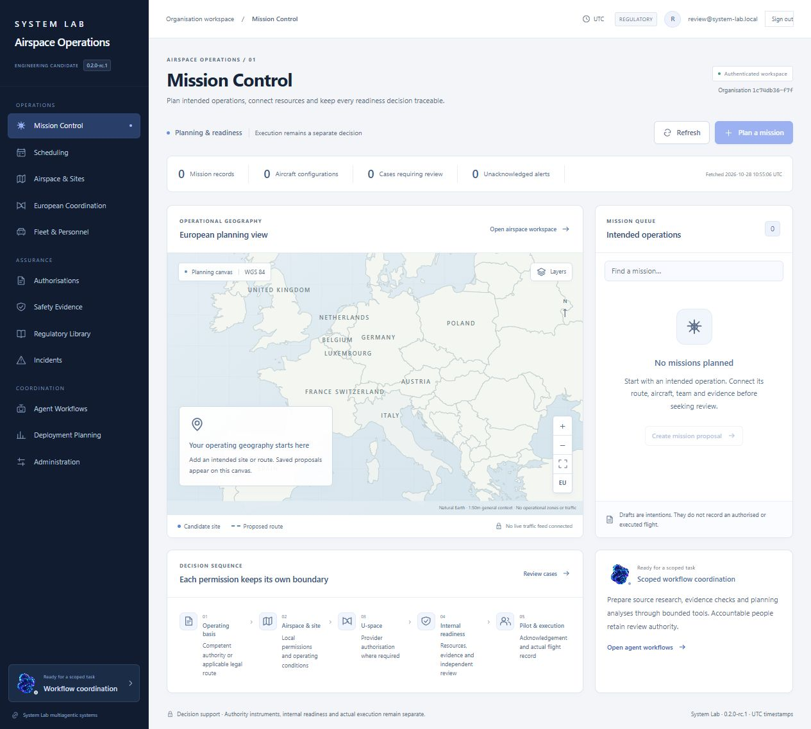
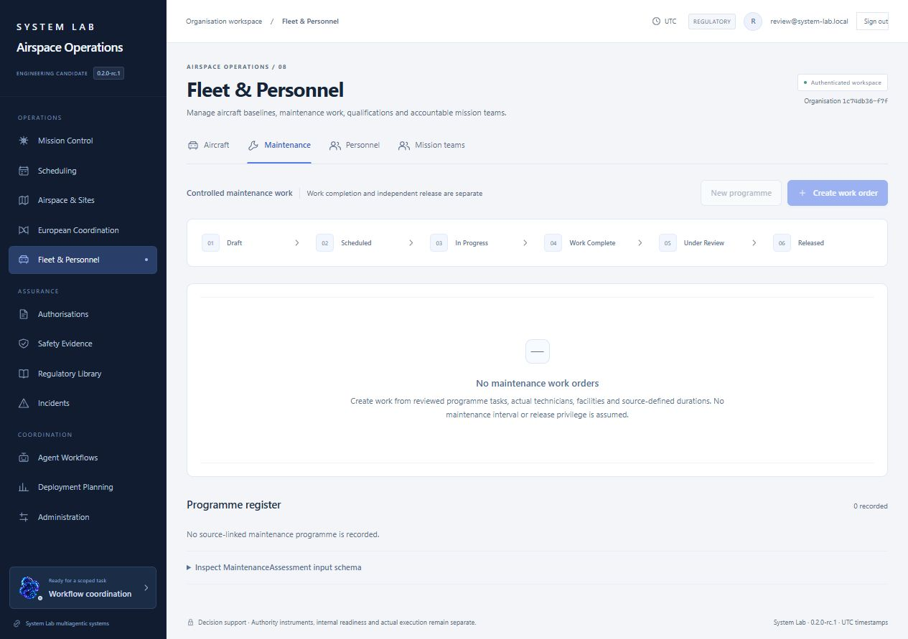
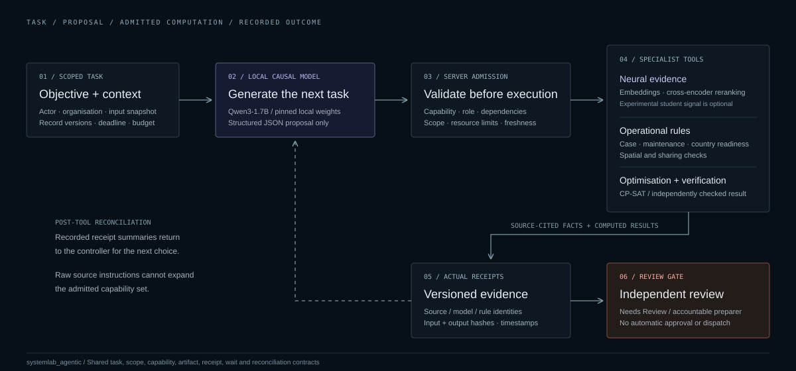
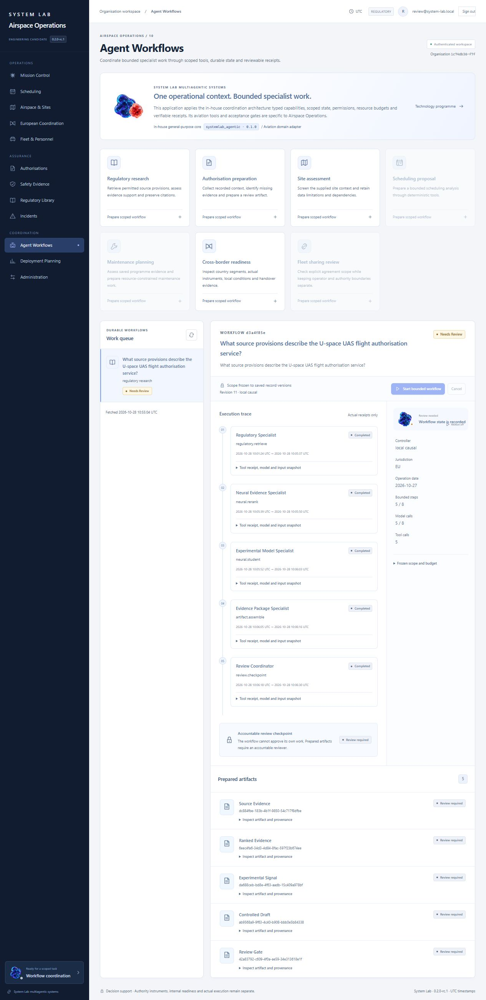

# System Lab Airspace Operations

Installable operational management and decision support for civilian unmanned-aircraft services. **0.2.0-rc.1 is a published engineering release candidate.** The original specification and incomplete acceptance gates remain inspectable.



The product connects intended operations, source-linked authorisation cases, aircraft readiness, European coordination and resource planning. Its React/TypeScript interface is backed by Python services, persistent transactional records, leased workers, controlled evidence and an audit trail. A pristine operational workspace is empty.

## Workspaces

| Workspace | Connected behaviour |
| --- | --- |
| Mission Control | Operational state, source freshness, readiness, alerts and accountable work. Authorised imports remain separate from accepted live provider feeds. |
| Airspace and Authorisations | Spatial evidence, explicit vertical references, source-linked cases, separate permission instruments and controlled review. |
| Fleet and Maintenance | Configuration baselines, utilisation and approved-programme triggers, defects, work orders and resource-constrained maintenance proposals. |
| European Coordination | Country segments, legal routes, local instruments, handovers and inspectable country-pack validation status. |
| Scheduling and Sharing | CP-SAT proposals, a separately implemented verifier, scoped owner/operator consent and physical-resource reservation checks. |
| Agent Orchestration | Actual local language-model proposals, admitted specialist execution, persisted receipts, pause/resume/cancel and independent-review checkpoints. |



Maintenance release, country permissions, U-space permission, internal dispatch readiness, pilot acknowledgement and actual execution retain separate meanings. A successful internal check does not issue an authority instrument or command an aircraft.

## A generative controller with bounded specialist tools



The local Qwen3-1.7B controller actually generates a structured next-tool proposal. A deterministic server boundary checks its scope, role, dependencies, input revisions and budget before the tool executes. Pretrained embeddings and a cross-encoder perform source retrieval and ranking; operational rules, CP-SAT and independent verifiers compute their own results.

The new [`systemlab_agentic`](backend/systemlab_agentic) package supplies reusable task, scope, capability, artifact, receipt, wait and reconciliation contracts. Airspace and a separate document-research adapter consume the same core. This fresh implementation follows the [System Labs multiagentic systems programme](https://giletto-systems-lab.michele-giletto.chatgpt.site/projects/multiagentic-systems); it does not copy proprietary trading/SPINS assets or claim wire compatibility with trading-specific commands. [Contract mapping](docs/multiagentic-contract-mapping.md) records that boundary.

The interface additionally reuses the owner's actual **2.5D WebGL companion presentation runtime**: five existing distributed browser/PNG resources copied byte-for-byte under express permission. The new adapter supports workflow-state mapping, reduced motion, application pause and a static-image fallback. Presentation state is separate from model inference, permissions and flight execution. [Provenance](frontend/public/vendor/systemlab-companion/provenance.json) records exact file identities and the reserved-rights boundary; no synchronized upstream package version is claimed from an installation that was updating during inspection.



The controller can prepare internal work. It cannot grant permissions, approve its own work, broaden credentials, submit to an authority, send correspondence, reserve resources or control an aircraft. Controlled artifacts finish at **Needs Review**. Source text and user uploads do not become supervisory instructions.

The earlier literal-language student remains an optional experimental signal. This release does **not** claim new student weights, additional training or improved student performance. It is separate from the generative controller and pretrained retrieval models. See the [model card](docs/model-card.md) and [agent contracts](docs/agent-contracts.md).

## Executed evidence

- The [first actual causal-controller run](release-evidence/v0.2.0-rc.1/orchestration-local-20261028T092208Z.json) generated five successive JSON proposals and executed real neural tools. It reached Needs Review in **204.91 seconds** in the recorded CPU environment. The first cold step took 169.724 seconds; later steps took approximately 8.5–9.5 seconds.
- The [small native/causal comparison](release-evidence/v0.2.0-rc.1/causal-comparison.json) contains four actual runs over two developer-authored, source-grounded research queries. All four ended at Needs Review. This tiny proxy sample establishes neither superiority nor legal-answer reliability.
- An [actual UI-and-worker run](release-evidence/v0.2.0-rc.1/actual-ui-workflow.json) separately records five Qwen/neural steps, 12 supporting passages and the final Needs Review gate. Its timestamps and cold-start work differ from the first 204.91-second experiment and are not combined into one performance figure. Comparison timings are confounded by run order and cache reuse; no speed benefit is claimed.
- [Controller identity verification](release-evidence/v0.2.0-rc.1/controller-integrity-verification.json) checked all 11 pinned files, totalling 4,079,448,540 bytes. This verifies artifact identity, not the safety of a model's legal judgement.
- [Executed software checks](release-evidence/) cover tenant boundaries, admission, changed inputs, model outage, source injection, cancellation, recovery, scheduling and operational rules. Exact commands, counts and failures belong to their recorded release environment.

Software verification, qualified domain review and real operational acceptance remain separate. No test fixture, historical replay or model agreement is described as a real flight or an authority decision.

## Install locally

The core works without System Lab hosting or a hosted inference subscription. Python 3.13 and `uv` are required; building the frontend from source also requires Node 22.12 or newer and npm. The downloadable application includes a built interface.

```powershell
uv sync --frozen --extra dev
python scripts/prepare_corpus.py
cd frontend
npm ci
npm run build
cd ..
$env:PYTHONPATH='backend'
.venv/Scripts/python.exe -m airspace.cli check
.venv/Scripts/python.exe -m airspace.cli user-add --organisation 'Your organisation' --email 'you@example.org' --role administrator
.venv/Scripts/python.exe -m airspace.cli serve --host 127.0.0.1 --port 8787
```

Open `http://127.0.0.1:8787`. Passwords are entered interactively; there is no default account. Provision role-specific users under the returned organisation ID. Administrator status does not confer reviewer authority. On Linux use `.venv/bin/python` and the corresponding shell environment syntax.

Run the durable worker separately:

```powershell
$env:PYTHONPATH='backend'
.venv/Scripts/python.exe -m airspace.cli worker
```

For explicitly enabled local neural/causal inference:

```powershell
uv pip install --python .venv/Scripts/python.exe --require-hashes -r requirements-neural.lock.txt
.venv/Scripts/python.exe scripts/prepare_neural.py --component encoder --component reranker
.venv/Scripts/python.exe scripts/prepare_controller.py
```

Then select `local_causal` when creating an authenticated agent workflow. The controller and retrieval models use pinned revisions, safetensors and local-only loading with remote code disabled. The controller files occupy approximately 4.08 GB before runtime overhead; allow additional RAM for model loading, source encoding and services. Recorded CPU performance is evidence for its tested machine, not a guaranteed minimum configuration. [Model administration](docs/model-administration.md) and [agent contracts](docs/agent-contracts.md) describe configuration, budgets and degradation.

The API publishes `/api/v1/openapi.json`, `/api/docs` and authenticated calculation/agent schemas. Configuration and operator responsibilities are documented in the [administrator handbook](docs/administrator-handbook.md), [operator handbook](docs/operator-handbook.md), [provider setup guide](docs/data-provider-setup.md) and [recovery runbook](docs/recovery-runbook.md).

## Data and jurisdiction coverage

The research foundation contains **9,833 actual English EASA passages** with preserved editions, checksums and source anchors. The UAS June 2026 and U-space May 2024 reference consolidations are not asserted to be authentic OJ editions or complete current legal coverage. The corpus's checked temporal snapshot is explicit; unsupported dates and jurisdictions abstain or remain incomplete.

Luxembourg and Italy require qualified reconciliation and review. Other countries in the registry are not thereby validated. UK applicability remains separate. National source-language documents remain in their original languages; no machine translation is presented as authoritative English. [SOURCE_REGISTER.md](SOURCE_REGISTER.md), [coverage](sources/coverage.json) and [rights review](sources/rights-review.json) record the actual retrievals, failures and reuse boundaries.

## Releases and acceptance

**0.2.0-rc.1: Published and independently retrieved.** [Download the application ZIP](https://github.com/michelegiletto-beep/airspace-operations/releases/download/v0.2.0-rc.1/System-Lab-Airspace-Operations-0.2.0-rc.1.zip) or inspect the [release and its nine assets](https://github.com/michelegiletto-beep/airspace-operations/releases/tag/v0.2.0-rc.1), including checksums, SBOM, provenance and verification evidence. The ZIP is **10,122,929 bytes**, SHA-256 `a66a23080654a34133b377c47d549fd83a02907ea6b04805ce272f5619c7273f`; its source tag is `3d5376758493f8e791dce85968947878990c6b6f`. The exact archive was separately extracted, installed and tested: **266 passed, 17 skipped**. The skips include the PostgreSQL profile and the licensed original XML snapshot excluded from the public package.

The tag and application ZIP are frozen. Their embedded publication records describe the assembly checkpoint; [the current publication ledger](publication/status.json) and [handover](HANDOVER.md) record subsequent public retrievals without rewriting the released bytes.

The [public static evaluation viewer](https://huggingface.co/spaces/Magic51/system-lab-airspace-evaluation) makes the four recorded comparison trials, five-step UI workflow, 12 cited passages and original student failure cases inspectable without model compute or an operational instance. It runs no live inference. Its source and evidence are independently retrievable; it is not the production platform.

The [previous v0.1.0-rc.1 release](https://github.com/michelegiletto-beep/airspace-operations/releases/tag/v0.1.0-rc.1) and frozen ZIP remain available and unchanged. The public [System Labs project dossier](https://giletto-systems-lab.michele-giletto.chatgpt.site/projects/airspace-operations) separates documentation/download hosting from authenticated operational deployment.

The exercised local portability profile uses SQLite. [Actual isolated CI on the exact released source](https://github.com/michelegiletto-beep/airspace-operations/actions/runs/40683325217) also built and started the containers, completed a job through the running worker/API, passed 16 PostgreSQL/PostGIS/vector/concurrency tests and verified pg_dump/pg_restore with the ordinary application role. Local verification passed 267 Python tests with 16 PostgreSQL skips, 69 frontend tests and dependency audits; those separate environments are not added into a fabricated single test total. National packs, accepted live operational feeds, complete methodology coverage and production-scale resilience retain separate assurance gates. Inspect [capabilities](capabilities.json), [requirement traceability](REQUIREMENTS_TRACEABILITY.csv), [known limitations](docs/known-limitations.md), [threat model](THREAT_MODEL.md) and [safety boundary](SAFETY_BOUNDARY.md).

This is decision-support software. It is not an autopilot, certified Detect and Avoid system, separation service, air traffic control system, competent authority or U-space provider. Software tests do not approve flights.

New code is Apache-2.0. Regulatory material, third-party models, dependencies and the owner's Indigo/Coral artwork retain their own rights. No private operator records, credentials or cached third-party foundation-model weights belong in public releases.


## Publication tooling

Publication-only image/schema checks use a separate hash-locked profile: `uv pip install --python .venv/Scripts/python.exe --require-hashes -r requirements-publication.lock.txt`. These packages are not required by the operational API. Run `python scripts/verify_sbom.py` for CycloneDX format validation against the pinned official specification, and the publication verification scripts for actual media/report checks. The final SBOM includes core, optional neural and optional publication dependencies, pinned excluded pretrained models, the distributed experimental student and the five separately reserved presentation files.
