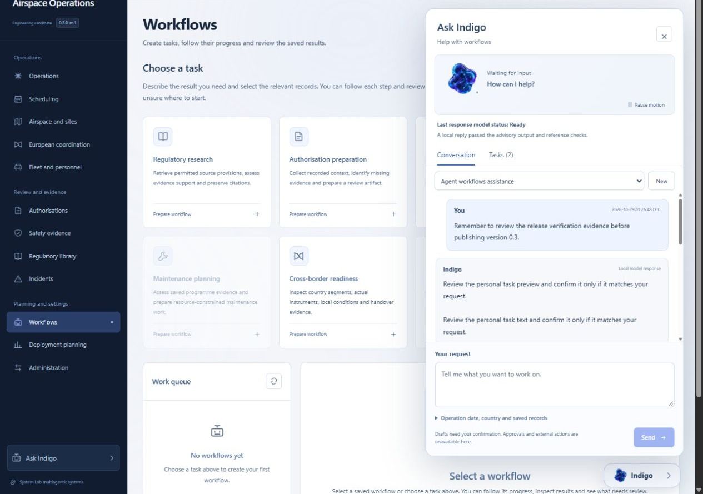
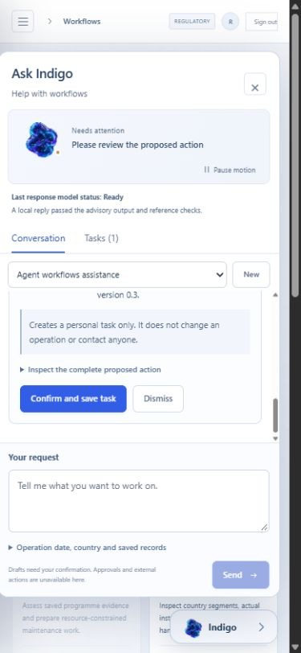

# System Lab Airspace Operations

Version [0.3.1-rc.1](https://github.com/michelegiletto-beep/airspace-operations/releases/tag/v0.3.1-rc.1) is a published engineering candidate. Its exact archive passed 479 tests with 20 skipped; the interface passed 123 tests. Current-source container, worker, PostgreSQL and restoration checks succeeded. All nine public assets were anonymously retrieved and digest-matched. This increment improves task readability, the visible version and mobile panel fit. See [known limitations](docs/known-limitations.md), including the frozen mobile image filename mismatch. Full original acceptance and operational acceptance remain incomplete.

Software for planning and reviewing civilian drone operations. It keeps intended missions, aircraft, personnel, permissions, evidence and tasks in one application. The interface uses persistent Python services and a database. A new installation contains no fictional flights or customer records.

Previous published version [0.3.0-rc.1](https://github.com/michelegiletto-beep/airspace-operations/releases/tag/v0.3.0-rc.1) is a published engineering candidate. The exact ZIP passed a clean installation and 407 software tests, with 20 skipped. All 19 PostgreSQL checks, actual containers, a running worker, backup/restoration and 107 interface tests passed separately. All nine release assets were anonymously downloaded and matched their published SHA-256 digests. The [previous 0.2 candidate](https://github.com/michelegiletto-beep/airspace-operations/releases/tag/v0.2.0-rc.1) and [first 0.1 candidate](https://github.com/michelegiletto-beep/airspace-operations/releases/tag/v0.1.0-rc.1) remain available with unchanged tags and bytes.

## Start with a task

Record the operation you intend to carry out. Add the real aircraft, people, location and supporting documents as they become available. The application identifies missing information and keeps draft work separate from reviewed evidence and permissions.

This revision implements a persistent local-model conversation, saved personal tasks and previews of internal draft actions that require your confirmation. The local model selects guidance and source, step and action identities; displayed guidance comes from a controlled registry and recorded state. Its owned companion animates during normal use, with an animated fallback and a restrained reactive background. Pause and reduced-motion settings take precedence. Actual browser, animated fallback, pause and current mobile task evidence are retained under release-evidence/v0.3.0-rc.1/.





These are actual captures from an isolated software-review workspace. They show no customer operation or flown mission.

The companion does not issue a permission or approve its own work. Animation does not prove that a model has finished or that a flight is ready. A missing local model must remain visibly unavailable. All real workspaces remain usable when language-model generation is unavailable.

## What the application records

| Area | Work |
| --- | --- |
| Missions | Intended operation, resources, current status and missing information |
| Authorisations | Source documents, requirements, review comments and separate permission records |
| Airspace | Proposed sites and routes, coordinate and height references, and data limitations |
| Aircraft and personnel | Configuration, maintenance evidence, qualifications and availability |
| Planning | Resource proposals, independent schedule checks and reservations |
| Country coordination | The countries along a route, applicable instruments and handovers |
| Tasks and assistance | Saved work, explanations and proposed internal drafts requiring confirmation |
| Incidents | Recorded events, approved procedures, accountable actions and evidence |

Internal review, authority permission, U-space permission, pilot acknowledgement and actual flight execution remain separate records. The software does not command aircraft or activate provider services.

## Install on your computer or server

Use Python 3.13 and uv. Building the interface from source also needs Node 22.12 or newer and npm. The [downloadable archive](https://github.com/michelegiletto-beep/airspace-operations/releases/download/v0.3.1-rc.1/System-Lab-Airspace-Operations-0.3.1-rc.1.zip) includes the built interface. It contains 12,504,321 bytes and has SHA-256 `0917f468624e35c64829f1591d389fadf51f4528f027d7dc614f1c3fb2b7b750`. Read the [schema 3 upgrade instructions](docs/upgrading-to-0.3.md) before updating an existing installation.

```powershell
uv sync --frozen --extra dev
.venv/Scripts/python.exe scripts/prepare_corpus.py
cd frontend
npm ci
npm run build
cd ..
$env:PYTHONPATH='backend'
.venv/Scripts/python.exe -m airspace.cli check
.venv/Scripts/python.exe -m airspace.cli user-add --organisation 'Your organisation' --email 'you@example.org' --role administrator
.venv/Scripts/python.exe -m airspace.cli serve --host 127.0.0.1 --port 8787
```

Open `http://127.0.0.1:8787`. Enter a password when prompted. There is no default account. Add colleagues under the returned organisation ID with the roles they need. An administrator is not automatically a reviewer. Linux uses `.venv/bin/python` and its corresponding shell environment syntax.

Run the background worker separately:

```powershell
$env:PYTHONPATH='backend'
.venv/Scripts/python.exe -m airspace.cli worker
```

Local model files are an explicit optional installation:

```powershell
uv pip install --python .venv/Scripts/python.exe --require-hashes -r requirements-neural.lock.txt
.venv/Scripts/python.exe scripts/prepare_neural.py --component encoder --component reranker
.venv/Scripts/python.exe scripts/prepare_controller.py
```

The pinned Qwen3-1.7B files occupy approximately 4.08 GB before runtime overhead. Allow additional memory for model loading, retrieval and services. Earlier CPU timings describe their recorded machine; they are not a guaranteed performance target. Read the [model setup guide](docs/model-administration.md) and [administrator handbook](docs/administrator-handbook.md) before loading private operational material.

## Evidence and limitations

[Run 40803017486](https://github.com/michelegiletto-beep/airspace-operations/actions/runs/40803017486) verified frozen source `331b6e220fec5254c4c2f167cab3ad86d8905456`. The source suite and exact-archive installation each passed 407 tests, with 20 skipped. The 19 PostgreSQL checks passed in their separate container environment, including concurrent access and workflow isolation; running-worker and backup/restoration checks also passed. The interface suite passed 107 tests and its production build completed. The [release assets](https://github.com/michelegiletto-beep/airspace-operations/releases/tag/v0.3.0-rc.1) include the exact installation receipt, current CI record, provenance, release gates, checksums and SBOM. [Independent download evidence](release-evidence/v0.3.0-rc.1/cycle-20261030-public-downloads.json) records all nine public asset hashes. Earlier 0.2 evidence stays labelled with that release.

Recorded 29 October browser verification used one local Qwen generation and one durable reservation, followed by explicit personal-task confirmation and database/audit checks. Actual mobile and desktop layouts, animation, animated fallback and pause checks are preserved with their source identities. No new student training is claimed.

Hugging Face presentations for 0.3 remain Prepared. The previously published model, dataset and 0.2 evidence Space are unchanged. The current in-app browser is signed out and no usable native-browser session or cached Hub token is available. The System Lab page is published at version97, source `309b6fac69cfbe51278da6d116545cf2916251b7`. All 37 checked resources passed independent retrieval, including unchanged prior releases. The page explicitly identifies the evidence Space as its published 0.2 record. [Publication status](publication/status.json) records each destination separately.

The experimental literal-language student and its source annotation dataset are unchanged. Its 81.82% agreement on 77 unreviewed machine labels remains below the deterministic literal-word baseline's 100%. It is not promoted, and it does not establish legal correctness. No new training, operational prediction or benchmark improvement is claimed.

The regulatory corpus preserves 9,833 actual EASA passages with editions, checksums and anchors. It does not establish complete current European law. Luxembourg and Italy still need qualified reconciliation. Other country entries are registered geography, and UK applicability remains separate. Original source languages and legal meaning are preserved. See the [source register](SOURCE_REGISTER.md).

No accepted live telemetry, weather, airspace or contracted U-space feed is implied by installation. Missing information remains missing. See [capabilities](capabilities.json), [known limitations](docs/known-limitations.md), [safety boundary](SAFETY_BOUNDARY.md), [recovery instructions](docs/recovery-runbook.md) and [original requirement traceability](REQUIREMENTS_TRACEABILITY.csv).

This is an engineering candidate. It is not certified separation, Detect and Avoid, air traffic control or a flight approval. Adopting organisations must establish lawful data access, real records, approved procedures, competent review, national applicability and permissions, and their own acceptance evidence.

New application code uses Apache-2.0. Existing System Lab artwork and presentation files retain reserved rights; regulatory documents, third-party models and dependencies keep their own terms. Private records, credentials and cached foundation-model weights are excluded from public releases.


## Upgrade compatibility

Version 0.3 uses schema marker 3 because older applications do not protect actor-private companion records. Stop every old API, worker and scheduled client before upgrading; mixed-version rolling deployment is unsafe. Follow [the upgrade procedure](docs/upgrading-to-0.3.md). Never remove marker 3 to force an older version to start.
