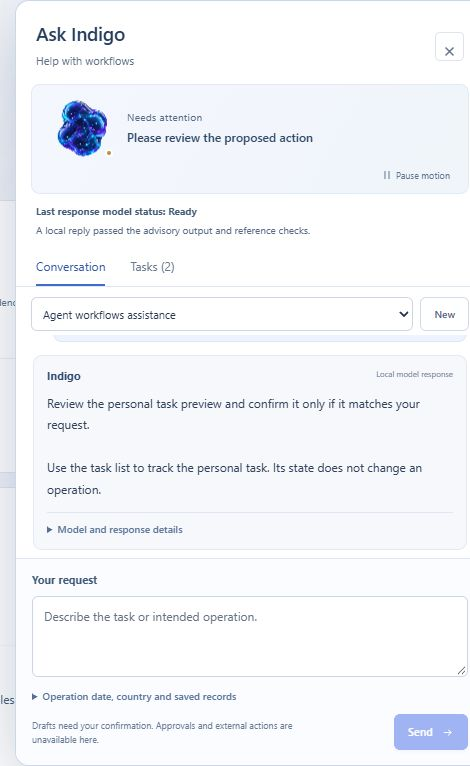
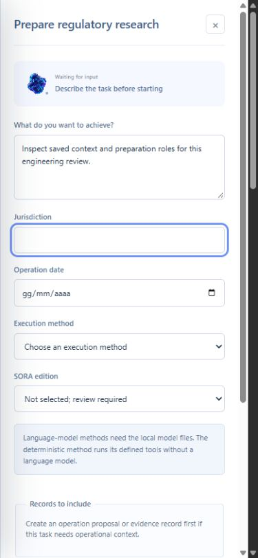
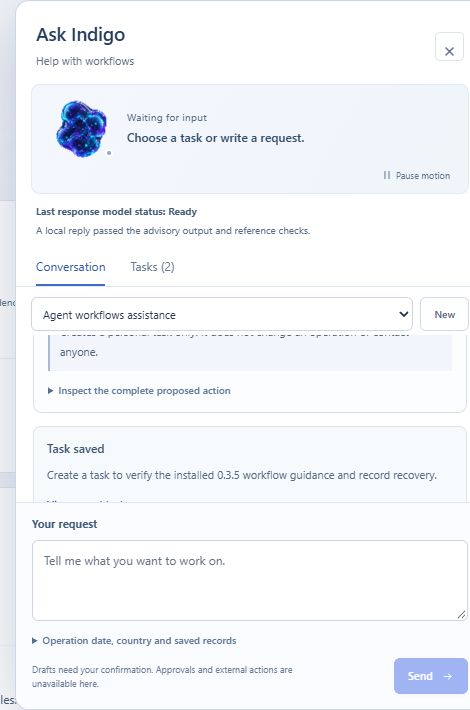
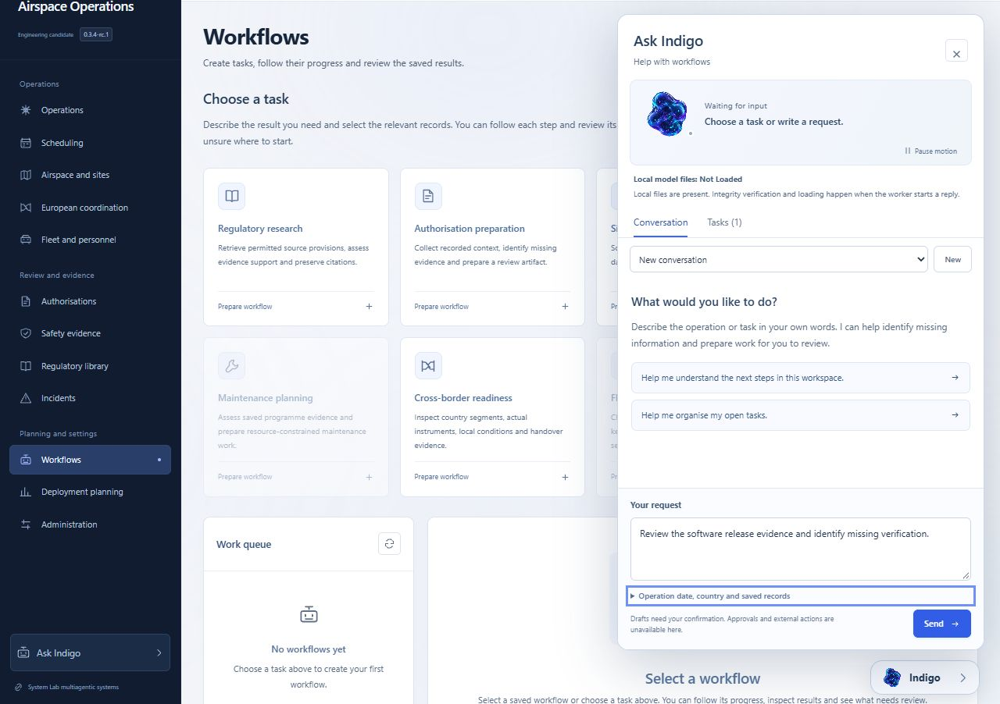
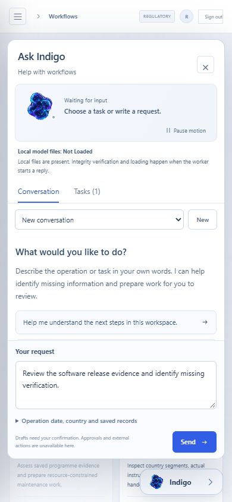

# System Lab Airspace Operations

A self-hosted application for civilian UAS planning, authorisation evidence, fleet and personnel records, scheduling, incident records and local workflow assistance. It includes the interface, Python API, persistent database and workers. A new operational workspace starts empty.

## Current candidate

Version 0.3.8-rc.1 repairs PostgreSQL extension compatibility, rejects incomplete database initialisation and updates OpenTelemetry API for its trace-context parsing advisory. Read the [candidate notes](publication/releases/0.3.8-rc.1/release-notes.md), [release pipeline](https://github.com/michelegiletto-beep/airspace-operations/actions) and [release downloads](https://github.com/michelegiletto-beep/airspace-operations/releases). Publication requires successful exact-source, dependency, container, rights, secrets and clean-installation gates. The attached receipts identify actual results. Original specification acceptance, stable release and operational acceptance remain false.

Start with the [operator handbook](docs/operator-handbook.md). Choose a task, provide actual records and evidence, review missing inputs and confirm only the internal drafts your role permits. The local companion can prepare work; server permissions, input versions, deterministic checks and independent review remain authoritative. Internal review, authority permissions, U-space authorisation, dispatch and flight execution remain separate.

For installation, use the [administrator handbook](docs/administrator-handbook.md), [model setup guide](docs/model-administration.md) and [upgrade procedure](docs/upgrading-to-0.3.md). PostgreSQL deployments need separate administrator and application credentials. An incomplete existing volume requires [controlled recovery](docs/recovery-runbook.md); the readiness check does not repair or discard it. Local model weights are an optional separate installation.

The previously verified [0.3.7 release](https://github.com/michelegiletto-beep/airspace-operations/releases/tag/v0.3.7-rc.1) remains available. [Publication status](publication/status.json) records each destination separately. Previous tags, downloads, source text, artwork rights and measurements remain preserved. The experimental student is unchanged and unpromoted. This repair adds no model call, training or operational record.



Recorded 0.3.6 software review. This fixed capture is not a 0.3.8 container test or an operational flight. The installed companion animates and honours pause and reduced-motion preferences. See [reserved artwork rights](THIRD_PARTY_NOTICES.md).

<details>
<summary>Earlier README checkpoints and installation records</summary>

The following sections retain their original dates, versions and evidence. They do not describe the current release state.

## Archive verification update

The unpublished 0.3.7 candidate also repairs the default Windows archive verification path. The complete installation, CLI, empty API and unfiltered pytest checks remain required. An explicit private work root is optional; paths and isolated child configuration are recorded. Existing Prepared artifacts and published releases remain unchanged. Final-source and actual default-run evidence define the result; focused helper tests alone do not establish installation success.

## Restore validation checkpoint, 9 November 2026

The 0.3.7 repair is implemented at `bfc3c9627226e9e73d419a06406946f71f8ae825`. Missing or invalid SQLite backups now fail before target creation. Existing targets were already refused; no ordinary existing-target overwrite was observed. Read-only input validation, exclusive target creation and guarded cleanup passed 15 focused regressions. The Windows source suite passed 598 tests with 21 skipped; the interface passed 205. The first remote engineering job passed 599 Linux tests with 20 skipped, 19 PostgreSQL checks and actual containers, worker and restoration.

A real existing engineering backup was restored through the new CLI and read through the API and browser. The 20 records and two tasks are unchanged; the preview audit51 includes only two verification sign-ins. No model call, training or operational record was added. The primary remains 0.3.5 with valid audit49.

GitHub failed internally before the publisher job; one full retry failed internally before jobs. The first engineering success is not a completed release. The default Windows archive verifier also failed during nested extraction with WinError206; a separate short-path check is recorded without waiving that failure. Published software remains 0.3.6, the three Hugging Face presentations remain at 0.3.6, and System Lab remains version103. A new local package is Prepared with a verified short-path Windows installation; its default nested verifier remains failed with WinError206. No new public candidate is claimed. Original acceptance, stable release and operational acceptance remain false. Read `improvement/cycles/2026-11-09T142608Z-restore-validation.json` and `publication/status.json`. Next: recheck platform recovery and finish the unchanged pipeline and independent downloads before publication or primary promotion. Earlier sections below are historical.

## Development candidate 0.3.7-rc.1

0.3.7-rc.1 is an unpublished development candidate for CLI restore input validation. A missing SQLite backup path can otherwise be created as an empty database and accepted as a restore source, producing an empty target with a misleading success report. Existing target files are already refused; this issue concerns the missing input and false success for a new target. The repair is being verified separately; no new source-suite, interface, container, archive or operational acceptance result is claimed here.

The published 0.3.6 release remains frozen and retains the earlier restore behavior. Before using restore in that release, verify that the backup file already exists and keep independent copies of the database, objects and audit key. Do not treat a successful restore message as proof that the expected application records were recovered. The primary remains at its separately verified 0.3.5 installation; no 0.3.6 primary promotion is claimed.

Original specification acceptance, stable release and operational acceptance remain false. No model call, training run, operational record or external action is added by this metadata update. See [candidate notes](publication/releases/0.3.7-rc.1/release-notes.md). Earlier checkpoint sections below retain their historical scope.

## Published confirmation candidate, 8 November 2026, 17:34 UTC cycle

[0.3.6-rc.1](https://github.com/michelegiletto-beep/airspace-operations/releases/tag/v0.3.6-rc.1) is published and independently retrieved from `d36509ef90cdf72d08aa342ef87259d47ab71814`. All nine GitHub assets match their public digests. ZIP: 17,599,454 bytes, SHA-256 `a5d8661dbfc635de631926ca3482a318999c5d7849efc91042b85be53ff5456e`. Exact-source CI 42507531487 and the separate archive installation passed 583 tests with 20 skipped; the interface passed 205 and PostgreSQL passed 19. Actual container, worker and restoration checks passed.

One real offline Qwen reply displayed one confirmation instruction. The task stayed unsaved until explicit confirmation; historical records and the 0.3.5 primary remain unchanged. No training or operational record was added. System Lab 103 and all three Hugging Face presentations are published and independently verified. The corrected Site package preserves 667 prior public files and links the new GitHub ZIP. Ten Airspace Site tests pass; six global Site failures match the prior recorded baseline. Rejections and failed intermediate commands are preserved.

Original acceptance, stable release and operational acceptance remain false. Read `improvement/cycles/2026-11-08T173403Z-confirmation-copy.json` and `publication/status.json`. Next: verify a separate exact 0.3.6 Windows installation before primary promotion. Earlier sections below are historical.

# System Lab Airspace Operations

0.3.6-rc.1 is a development candidate for concise personal-task confirmation and direct operator instructions. Current-source release, archive and public download checks remain pending. The current published and primary software remains 0.3.5-rc.1. See publication/status.json and release-evidence/v0.3.6-rc.1. No full original acceptance or operational acceptance is claimed.

[0.3.5-rc.1](https://github.com/michelegiletto-beep/airspace-operations/releases/tag/v0.3.5-rc.1) is a published engineering candidate for workflow preparation roles, saved-context recovery and mobile form access. All nine release assets were independently retrieved. Frozen source `9eead371e8afb5d38293e35d6e4ffef588ae7951`; ZIP SHA-256 `4c326d37066d6d787aeebe48eeba9932122e3ce052b64dc5bc474bc9ea6e3794`. Exact-source CI passed 578 source tests with 20 skipped, 205 interface tests and 19 PostgreSQL tests, with actual containers, worker completion and restoration. The exact archive installation separately passed 578 tests with 20 skipped. Failed earlier publication attempts and warnings remain recorded.

[Download the installable ZIP](https://github.com/michelegiletto-beep/airspace-operations/releases/download/v0.3.5-rc.1/System-Lab-Airspace-Operations-0.3.5-rc.1.zip), inspect the [release evidence](release-evidence/v0.3.5-rc.1/), or view the [System Lab project page](https://giletto-systems-lab.michele-giletto.chatgpt.site/projects/airspace-operations). System Lab 102 and all three Hugging Face presentations are independently verified. Experimental student weights and dataset records remain unchanged. A later Windows verification used one real local pretrained-controller call and explicit personal-task confirmation in a restored private engineering workspace. No new training or benchmark result is claimed. The primary now uses the exact separately installed 0.3.5 source and preserved optional interpreter; a separate fresh Windows core environment passed 577 tests with 21 skipped. Original acceptance, stable release and operational acceptance remain false.



Actual isolated software review with an unsent engineering request. No model reply, customer record, flight or authority approval is shown. The owned artwork retains its reserved rights in [third-party notices](THIRD_PARTY_NOTICES.md). [Desktop capture](publication/media/0.3.5-rc.1/workflow-context.jpg).

[Windows installation and local assistance verification](docs/verification/windows-0.3.5.md) records the actual model call, typed preview, confirmation, persistent task and unchanged primary records.



Recorded private engineering review, with no operational mission or model-training example.

Previous candidate [0.3.4-rc.1](https://github.com/michelegiletto-beep/airspace-operations/releases/tag/v0.3.4-rc.1) is a published engineering candidate for private draft continuity and read-only installation diagnostics. All nine download assets are independently retrieved. Source `f5dd93a7c5c7367101ea63147a5da99cb085addb`, exact archive installation, local Windows checks and System Lab 101 each have separate evidence. The Hugging Face presentations are independently verified for 0.3.4. The primary application is separately verified at 0.3.4 using the exact installed archive source and existing optional interpreter. The previous C project application source remains preserved.  See [publication status](publication/status.json), [release evidence](release-evidence/v0.3.4-rc.1/) and [candidate notes](publication/releases/0.3.4-rc.1/release-notes.md). The original specification remains incomplete; stable release and operational acceptance remain false.

Previous candidate [0.3.3-rc.1](https://github.com/michelegiletto-beep/airspace-operations/releases/tag/v0.3.3-rc.1) introduced explicit saved-task read recovery and a request-scoped retry that preserves the unsent draft. Its frozen source, tags, downloads and evidence remain available unchanged.

Version [0.3.2-rc.1](https://github.com/michelegiletto-beep/airspace-operations/releases/tag/v0.3.2-rc.1) is a published engineering candidate. It explains mission-proposal role permissions, integrates bounded publication-media checks and pins PyPDF 6.21.4 after three upstream denial-of-service advisories. Source and exact-archive suites each passed 542 tests with 20 skipped; 132 interface tests and 19 PostgreSQL checks passed with actual containers, a running worker and restoration. All nine release assets were independently retrieved. The earlier local 541 passed/21 skipped result is separate. [Release evidence](release-evidence/v0.3.2-rc.1/) and [publication status](publication/status.json) record exact scopes. The original specification remains incomplete; stable release and operational acceptance remain false.

Previous candidate [0.3.1-rc.1](https://github.com/michelegiletto-beep/airspace-operations/releases/tag/v0.3.1-rc.1) is a published engineering candidate. Its exact archive passed 479 tests with 20 skipped; the interface passed 123 tests. Release-source container, worker, PostgreSQL and restoration checks succeeded. All nine public assets were anonymously retrieved and digest-matched. This increment improves task readability, the visible version and mobile panel fit. See [known limitations](docs/known-limitations.md), including the frozen mobile image filename mismatch. Full original acceptance and operational acceptance remain incomplete.

Software for planning and reviewing civilian drone operations. It keeps intended missions, aircraft, personnel, permissions, evidence and tasks in one application. The interface uses persistent Python services and a database. A new installation contains no fictional flights or customer records.

Previous published version [0.3.0-rc.1](https://github.com/michelegiletto-beep/airspace-operations/releases/tag/v0.3.0-rc.1) is a published engineering candidate. The exact ZIP passed a clean installation and 407 software tests, with 20 skipped. All 19 PostgreSQL checks, actual containers, a running worker, backup/restoration and 107 interface tests passed separately. All nine release assets were anonymously downloaded and matched their published SHA-256 digests. The [previous 0.2 candidate](https://github.com/michelegiletto-beep/airspace-operations/releases/tag/v0.2.0-rc.1) and [first 0.1 candidate](https://github.com/michelegiletto-beep/airspace-operations/releases/tag/v0.1.0-rc.1) remain available with unchanged tags and bytes.

## Start with a task

Record the operation you intend to carry out. Add the real aircraft, people, location and supporting documents as they become available. The application identifies missing information and keeps draft work separate from reviewed evidence and permissions.

This revision implements a persistent local-model conversation, saved personal tasks and previews of internal draft actions that require your confirmation. The local model selects guidance and source, step and action identities; displayed guidance comes from a controlled registry and recorded state. Its owned companion animates during normal use, with an animated fallback and a restrained reactive background. Pause and reduced-motion settings take precedence. Actual browser, animated fallback, pause and current mobile task evidence are retained under release-evidence/v0.3.0-rc.1/.





These 2 November 2026 captures show an isolated development workspace and a real, unsent engineering request. They show no customer operation or flown mission. Earlier captures remain in their original release directories. Local model files were present but no model was loaded or called during this review.

The companion does not issue a permission or approve its own work. Animation does not prove that a model has finished or that a flight is ready. A missing local model must remain visibly unavailable. All real workspaces remain usable when language-model generation is unavailable.

## What the application records

| Area | Work |
| --- | --- |
| Missions | Intended operation, resources, current status and missing information |
| Authorisations | Source documents, requirements, review comments and separate permission records |
| Airspace | Proposed sites and routes, coordinate and height references, and data limitations |
| Aircraft and personnel | Configuration, maintenance evidence, qualifications and availability |
| Planning | Resource proposals, independent schedule checks and reservations |
| Country coordination | The countries along a route, applicable instruments and handovers |
| Tasks and assistance | Saved work, explanations and proposed internal drafts requiring confirmation |
| Incidents | Recorded events, approved procedures, accountable actions and evidence |

Internal review, authority permission, U-space permission, pilot acknowledgement and actual flight execution remain separate records. The software does not command aircraft or activate provider services.

## Install on your computer or server

Use Python 3.13 and uv. Building the interface from source also needs Node 22.12 or newer and npm. The published [0.3.3 archive](https://github.com/michelegiletto-beep/airspace-operations/releases/download/v0.3.3-rc.1/System-Lab-Airspace-Operations-0.3.3-rc.1.zip) includes the built interface. It contains 14,192,874 bytes and has SHA-256 `067c1b940d520177695402cd469823e35183e4a96d0bbc7af403fd9effb0d6f5`. These are frozen 0.3.3 bytes; no 0.3.4 download is claimed. Read the [schema 3 upgrade instructions](docs/upgrading-to-0.3.md) before updating an existing installation.

```powershell
uv sync --frozen --extra dev
.venv/Scripts/python.exe scripts/prepare_corpus.py
cd frontend
npm ci
npm run build
cd ..
$env:PYTHONPATH='backend'
.venv/Scripts/python.exe -m airspace.cli check
.venv/Scripts/python.exe -m airspace.cli user-add --organisation 'Your organisation' --email 'you@example.org' --role administrator
.venv/Scripts/python.exe -m airspace.cli serve --host 127.0.0.1 --port 8787
```

Open `http://127.0.0.1:8787`. Enter a password when prompted. There is no default account. Add colleagues under the returned organisation ID with the roles they need. An administrator is not automatically a reviewer. Linux uses `.venv/bin/python` and its corresponding shell environment syntax.

Run the background worker separately:

```powershell
$env:PYTHONPATH='backend'
.venv/Scripts/python.exe -m airspace.cli worker
```

Local model files are an explicit optional installation:

```powershell
uv pip install --python .venv/Scripts/python.exe --require-hashes -r requirements-neural.lock.txt
.venv/Scripts/python.exe scripts/prepare_neural.py --component encoder --component reranker
.venv/Scripts/python.exe scripts/prepare_controller.py
```

The pinned Qwen3-1.7B files occupy approximately 4.08 GB before runtime overhead. Allow additional memory for model loading, retrieval and services. Earlier CPU timings describe their recorded machine; they are not a guaranteed performance target. Read the [model setup guide](docs/model-administration.md) and [administrator handbook](docs/administrator-handbook.md) before loading private operational material.

## Evidence and limitations

[Published 0.3.3 verification](https://github.com/michelegiletto-beep/airspace-operations/actions/runs/41301492234) identifies frozen source `6f8364df25b942d49eb1b4ccaa40f27f70578dbb`. Source and exact-archive suites each passed 544 tests with 20 skipped; 160 interface tests and 19 PostgreSQL checks passed separately. Actual containers, a running worker and backup/restoration were exercised. [Its release assets](https://github.com/michelegiletto-beep/airspace-operations/releases/tag/v0.3.3-rc.1) include installation evidence, provenance, gates, checksums and SBOM. [Independent retrieval](release-evidence/v0.3.3-rc.1/cycle-20261101T105140Z-public-downloads.json) covers all nine public assets. Development 0.3.4 has separate evidence under [release-evidence/v0.3.4-rc.1](release-evidence/v0.3.4-rc.1/); passing checks do not imply its archive or publication has completed. Earlier evidence remains labelled with its original release.

Recorded 29 October browser verification used one local Qwen generation and one durable reservation, followed by explicit personal-task confirmation and database/audit checks. Actual mobile and desktop layouts, animation, animated fallback and pause checks are preserved with their source identities. No new student training is claimed.

The [System Lab project page](https://giletto-systems-lab.michele-giletto.chatgpt.site/projects/airspace-operations) remains at version 100, source `3639b489b2c36df8846c39f80f713c8733149f4c`; all 69 resources passed the preceding full retrieval. The [model card](https://huggingface.co/Magic51/system-lab-airspace-shall-router), [dataset card](https://huggingface.co/datasets/Magic51/system-lab-airspace-source-annotations) and [recorded evaluation Space](https://huggingface.co/spaces/Magic51/system-lab-airspace-evaluation) present 0.3.3 evidence. Their exact revisions and independently retrieved files are recorded in [publication status](publication/status.json). A fresh bounded review on 2 November matched selected current files and media; it did not repeat the complete ZIP or Site download. No 0.3.4 provider publication is claimed. Original weights, dataset rows and historical evidence remain unchanged. The static Space runs no model.

The experimental literal-language student and its source annotation dataset are unchanged. Its 81.82% agreement on 77 unreviewed machine labels remains below the deterministic literal-word baseline's 100%. It is not promoted, and it does not establish legal correctness. No new training, operational prediction or benchmark improvement is claimed.

The regulatory corpus preserves 9,833 actual EASA passages with editions, checksums and anchors. It does not establish complete current European law. Luxembourg and Italy still need qualified reconciliation. Other country entries are registered geography, and UK applicability remains separate. Original source languages and legal meaning are preserved. See the [source register](SOURCE_REGISTER.md).

No accepted live telemetry, weather, airspace or contracted U-space feed is implied by installation. Missing information remains missing. See [capabilities](capabilities.json), [known limitations](docs/known-limitations.md), [safety boundary](SAFETY_BOUNDARY.md), [recovery instructions](docs/recovery-runbook.md) and [original requirement traceability](REQUIREMENTS_TRACEABILITY.csv).

This is an engineering candidate. It is not certified separation, Detect and Avoid, air traffic control or a flight approval. Adopting organisations must establish lawful data access, real records, approved procedures, competent review, national applicability and permissions, and their own acceptance evidence.

New application code uses Apache-2.0. Existing System Lab artwork and presentation files retain reserved rights; regulatory documents, third-party models and dependencies keep their own terms. Private records, credentials and cached foundation-model weights are excluded from public releases.


## Upgrade compatibility

Version 0.3 uses schema marker 3 because older applications do not protect actor-private companion records. Stop every old API, worker and scheduled client before upgrading; mixed-version rolling deployment is unsafe. Follow [the upgrade procedure](docs/upgrading-to-0.3.md). Never remove marker 3 to force an older version to start.

</details>
