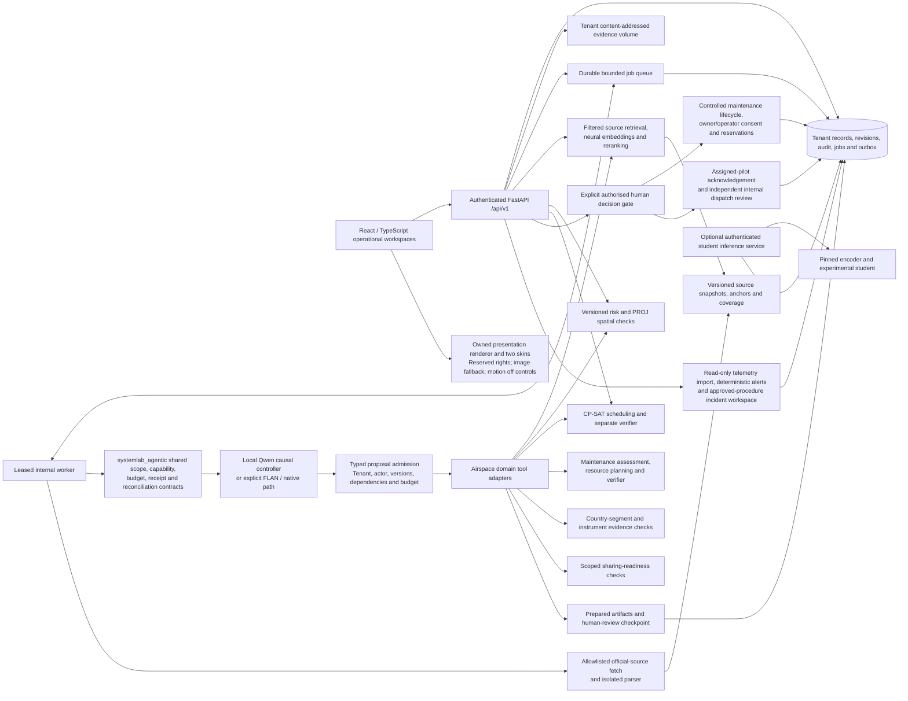

# Architecture and contracts

The API is modular, with explicit identity, storage, workflow, regulatory, spatial/risk, scheduling, fleet maintenance, European coordination, bilateral sharing, dispatch, monitoring, evidence and inference boundaries. SQLite is the exercised portability profile. PostgreSQL/PostGIS/pgvector container deployment is prepared; CI and deployment outcomes require their own evidence. Current spatial/retrieval algorithms use PROJ/local vectors, not a claimed database vector index. Object storage is a tenant-scoped content-addressed filesystem volume; an S3-compatible provider needs a separately reviewed adapter.

Every material write carries tenant and actor, an optimistic revision and a transactional audit/outbox event. Tenant-row locking serialises significant schedule/record/evidence updates. HMAC audit chains are verified against retained sequence count and externally retained head checkpoints. Ordinary APIs cannot edit audit rows. Jobs have typed allowlisted tools, per-tool roles, leases, bounded retries, deadline, pause/cancel/resume and persisted results/failures. No external authority or aircraft action tool exists.

The machine-readable API is docs/openapi.json and live /api/v1/openapi.json. Detailed deterministic calculation models are returned by authenticated /api/v1/contracts. Record envelopes use id,organisation_id,kind,title,status,data,version,created_by,created_at,updated_at. Preparation/decision metadata keys beginning with `_` are server-controlled. Financial inputs preserve provenance, dates and currency. Spatial inputs preserve WGS84 coordinates, vertical reference and uncertainty. Telemetry contracts preserve event/receipt times and replay mode.

## Agent execution and consequential decisions

`backend/systemlab_agentic` is a fresh domain-neutral implementation shared by the aviation and read-only document-research adapters. The Airspace worker uses the local Qwen controller to generate next-tool proposals, then independently validates each proposal before a domain tool runs. FLAN constrained selection and the native deterministic controller remain explicit alternatives. Source bodies do not become supervisory instructions. A source-date or context gap stays missing rather than being filled by a controller.

The durable worker loads the configured local controller/retrieval models in process and reuses bounded caches. These domain boxes are module boundaries, not a claim of separate microservices: advisory API endpoints can call the same risk, spatial, retrieval and solver functions synchronously. Jobs persist in the tenant database. The optional standalone experimental classification service is a separate authenticated path; orchestration does not require an HTTP round trip through it. Model absence never gives a workflow broader permissions or an undisclosed controller replacement.

Agent tools prepare analyses/artifacts; they cannot record owner/operator consent, approve a case, release maintenance, reserve aircraft, acknowledge as a pilot or release dispatch. Those actions pass through explicit authenticated services with current actor/role, independent review, source evidence and concurrency checks. Maintenance utilisation and completion provenance bind `evidence_ref` and exact `evidence_version`; reservation/dispatch require current Approved independently reviewed tenant evidence, not a stale copied completion. Controlled work-order completion captures the actual source revision on the server.

Cross-border checks distinguish host-issued confirmation from operator-documented STS/LUC submissions. Sharing acceptance does not transfer authorisations. Internal dispatch preserves separate pilot and reviewer records and leaves provider activation/aircraft execution unperformed. See [fleet and cross-border contracts](fleet-and-cross-border.md) and [agent contracts](agent-contracts.md).

## Reused presentation component

The frontend deliberately reuses **five byte-identical owned presentation resources**: three already distributed browser ESM modules and the original Indigo/Coral PNG skins. A new React adapter exposes only presentation state and the two selected appearances, disposes instances and forces motion off for global pause or reduced-motion preferences. It preserves optimised image/CSS fallback. There is no broker, trading, account, model-weight or aircraft-command integration in this component.

These files retain reserved proprietary rights, outside the Apache-2.0 grant for new code. [The vendor notice](../frontend/public/vendor/systemlab-companion/NOTICE.md) and [provenance](../frontend/public/vendor/systemlab-companion/provenance.json) preserve the exact file hashes and the distinct observed installation/package identifiers. This presentation reuse is separate from the fresh shared coordination core and does not import proprietary trading schemas, training recipes or strategy implementation.

Event streaming is authenticated /api/v1/events with tenant-scoped sequence cursors. It exposes action metadata, not private evidence text, and uses bounded30second streams for reauthentication/reconnect. Essential alerts, rules, forms and record work do not require a generative model. The optional local model service is separately deployable and cannot modify approval policy or source truth.

## Recorded container verification

The actual isolated GitHub run40678178924 at commit`e2c5e4ec55ec5bbb25901fee27b143d2b06ec35c` passed application/database container build and health, the already-running worker/API job check,16 PostgreSQL extension/concurrency/migration tests and pg_dump/pg_restore audit verification using the ordinary application role. See[CI evidence](../release-evidence/v0.2.0-rc.1/ci-verification.json). Earlier statements about unavailable local Docker describe the Windows host; the later remote check does not establish production-scale resilience or accepted live integrations.
