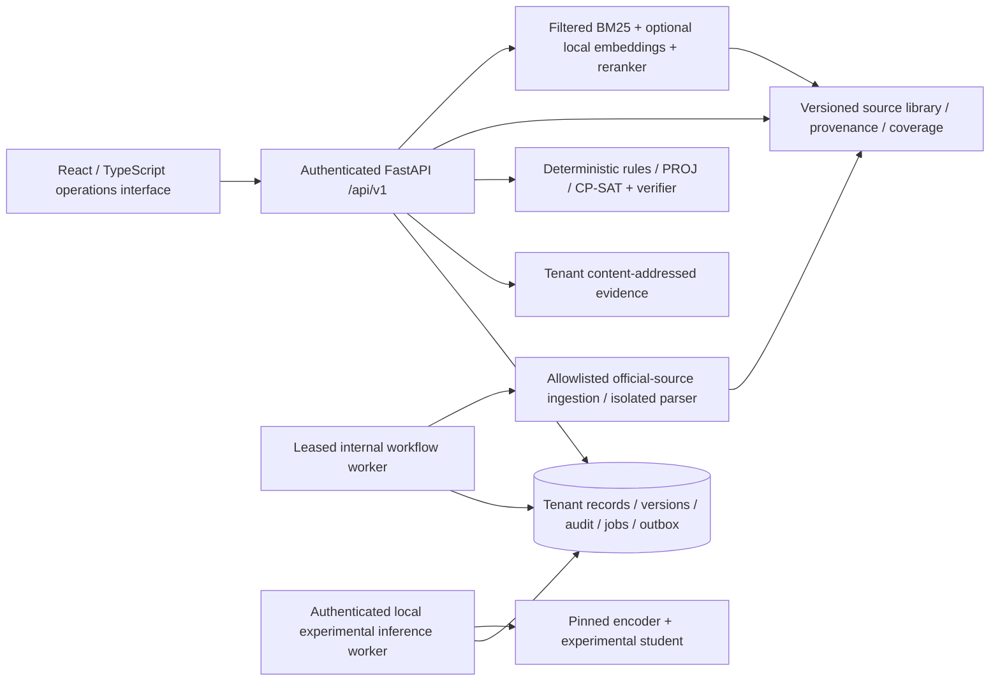

# Architecture and contracts

The API is modular, with explicit identity, storage, workflow, regulatory, spatial/risk, scheduling, monitoring, evidence and inference boundaries. PostgreSQL is the organisation deployment target; SQLite is the verified portability profile. PostGIS/pgvector deployment extensions are prepared but current algorithms use PROJ/local vectors, not an unverified database index claim. Object storage is a content-addressed filesystem volume in this candidate; an S3-compatible provider requires another reviewed adapter.

Every material write carries tenant and actor, an optimistic revision and a transactional audit/outbox event. Tenant-row locking serialises significant schedule/record/evidence updates. HMAC audit chains are verified against retained sequence count and externally retained head checkpoints. Ordinary APIs cannot edit audit rows. Jobs have typed allowlisted tools, per-tool roles, leases, bounded retries, deadline, pause/cancel/resume and persisted results/failures. No external authority or aircraft action tool exists.

The machine-readable API is docs/openapi.json and live /api/v1/openapi.json. Detailed deterministic calculation models are returned by authenticated /api/v1/contracts. Record envelopes use id,organisation_id,kind,title,status,data,version,created_by,created_at,updated_at. Preparation/decision metadata keys beginning with `_` are server-controlled. Financial inputs preserve provenance, dates and currency. Spatial inputs preserve WGS84 coordinates, vertical reference and uncertainty. Telemetry contracts preserve event/receipt times and replay mode.

Event streaming is authenticated /api/v1/events with tenant-scoped sequence cursors. It exposes action metadata, not private evidence text, and uses bounded30second streams for reauthentication/reconnect. Essential alerts, rules, forms and record work do not require a generative model. The optional local model service is separately deployable and cannot modify approval policy or source truth.
