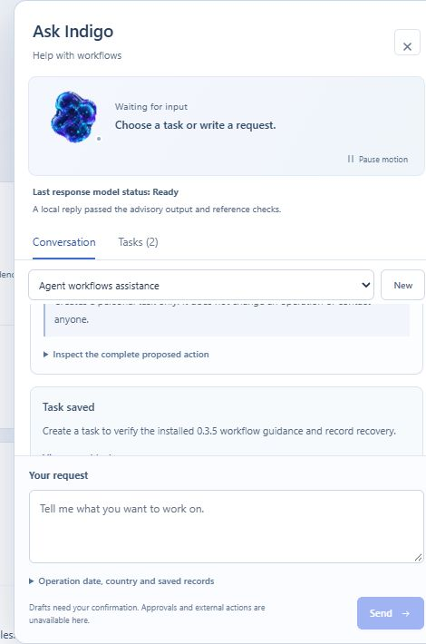

# Windows installation and local assistance verification

Recorded on 8 November 2026 for frozen source `9eead371e8afb5d38293e35d6e4ffef588ae7951`. This is a post-release software verification record. The release tag, archive and previous releases were not changed.

The 16,605,809-byte archive has SHA-256 `4c326d37066d6d787aeebe48eeba9932122e3ce052b64dc5bc474bc9ea6e3794`. Two new anonymous release API requests returned HTTP 504, and a later bounded ZIP request timed out. The installation explicitly used the exact cached archive independently retrieved earlier on the same date. All 1,096 source-manifest files matched. The GitHub connector confirmed the source commit and default branch. No successful fresh anonymous GitHub download is claimed for this cycle.

The fresh core environment used Python 3.13.1 on Windows. These commands ran in the separate extracted project, with a new private runtime and the inherited operator database and audit-key overrides absent:

```powershell
uv sync --frozen --extra dev
.venv/Scripts/python.exe -B -m airspace.cli check
.venv/Scripts/python.exe -B -m pytest -q
```

Installation passed. The diagnostic command did not create a runtime database or audit key. A separate actual TestClient probe verified an empty persistent database, version 0.3.5, zero records/jobs/organisations/audit entries and a 401 response for an unauthenticated case read. The full suite passed **577 tests, with 21 skipped and 3 warnings, in 114.83 seconds**. The test command took 119.656 seconds. The complete commands, outputs and environment scope are in [the Windows receipt](../../release-evidence/v0.3.5-rc.1/cycle-20261108T113227Z-fresh-windows-installation.json). This fresh environment does not claim a fresh optional neural installation.

The installed source also served a separate restored copy of the real engineering workspace, using the existing optional interpreter: PyTorch 2.14.1, Transformers 5.21.0 and Safetensors 0.8.0. Sentence Transformers and ONNX Runtime were absent; the causal controller uses Transformers directly. No package was added to the preserved optional environment.

The existing pretrained controller was `Qwen/Qwen3-1.7B`, revision `70d244cc86ccca08cf5af4e1e306ecf908b1ad5e`. Its 11 local manifest files, including its existing Apache 2.0 licence, were checked against their recorded hashes. Loading used local files and disabled remote code. This is a pretrained orchestration controller, not a newly trained System Lab foundation model.

One real browser request asked to create a personal task to verify the installed workflow guidance and record recovery. The actual model call used 583 input tokens and generated 45 output tokens. Recorded generation time was 21.110 seconds and model loading took 73.537 seconds. These are one-run measurements, not latency or quality guarantees. The model selected supplied guidance, next-step and draft-action identities. The server supplied the trusted wording and enforced the typed action.

Before explicit browser confirmation there were still two tasks and the action was Awaiting Confirmation. After pressing **Confirm and save task**, exactly one personal engineering task was added. It survived browser reload. The restored copy contained 25 records, three tasks, seven completed jobs and valid audit 55. Its original twenty records, users and roles were unchanged. It contained no operational records. The one-shot worker completed and exited, and the temporary API was stopped after verification. This copy and its private records are excluded from public artifacts and training data.



The native capture excludes the account header and shows the actual saved engineering request. The owned companion and presentation assets retain their reserved rights. This screenshot is recorded software evidence. In the application, normal WebGL companion frames changed in 3,767 of 9,500 measured pixels. Pause and resume controls were exercised and normal motion was restored. A paused screenshot timed out before bytes were returned, so this cycle makes no new paused-frame stability claim. Reduced-motion and animated-fallback evidence remains separately scoped to the existing interface tests and earlier browser receipts.

The owned primary was then stopped in a controlled cutover, using inspected process identities rather than process-name termination. A consistent private database/key backup was retained. The source's idempotent schema check passed, and the new API and worker became healthy. The primary uses the exact installed 0.3.5 source with the preserved optional interpreter. All twenty records and two original tasks stayed unchanged. The subsequent real browser sign-in added exactly one identity audit entry, session and outbox event; audit 49 verifies. The engineering task from the restored copy was not copied into the primary. Worker health proves liveness; the actual reply completion was verified separately in the restored workspace.

The current private recovery pointer is `runtime/review-v3/active-recovery.json`. Historical recovery scripts target older installations. Use the current pointer and inspect service ownership before starting anything. The original C application source, previous installed 0.3.4 source, audit key, existing policy and old release assets remain preserved. No aircraft command, authority decision, external communication or safety approval was added.

Three pinned Hugging Face cards were independently retrieved again with exact hashes. The public System Lab page and its checksum document were inspected; the canonical anonymous checksum verifier passed. An earlier generic HTTP probe returned 403 and a text-document download helper timed out; both are retained as verification-tool failures rather than hidden. The full fresh destination audit from the earlier release cycle remains historical evidence, not a claim that every public file was downloaded again in this cycle.

The original specification and all 198 requirement texts and statuses remain incomplete and unchanged. Eight existing evidence-reference fields differ between the preserved 0.3.3 development workspace and the released source; those are historical additions, not changes to requirement acceptance. One redundant confirmation instruction was observed in the actual reply and is recorded for a separate candidate. Existing student weights, datasets, training results and promotion state are unchanged. This run establishes neither operational acceptance nor aviation certification.
