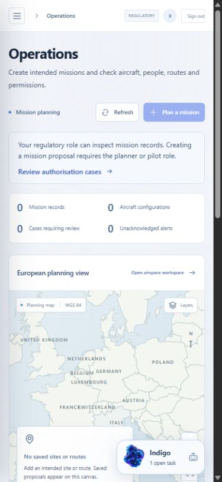

# System Lab experimental literal-language routing student

This repository contains a small experimental classifier for the literal presence of the English word `shall`. It does not determine whether a legal obligation exists, applies or has been met.

This card retains the unchanged experimental student and adds recorded context for the published 0.3.2 application candidate. The student weights, original dataset, training run and measured results are unchanged. Application changes require their own software verification.

## Application 0.3.2 release

Version 0.3.2-rc.1 is a published engineering candidate from source [2ebb8b20e515d9863a69b072bd963890e219e050](https://github.com/michelegiletto-beep/airspace-operations/tree/2ebb8b20e515d9863a69b072bd963890e219e050). Its 13,796,258-byte ZIP has SHA-256 `1634b9b7e36bd2b80b179a4e0429da7f0c9165434747fc9a62f03ede78cc772e`. All nine public release assets were independently retrieved and matched their published digests. [Download the 0.3.2 ZIP](https://github.com/michelegiletto-beep/airspace-operations/releases/download/v0.3.2-rc.1/System-Lab-Airspace-Operations-0.3.2-rc.1.zip) or [inspect its release and verification assets](https://github.com/michelegiletto-beep/airspace-operations/releases/tag/v0.3.2-rc.1).

The Operations workspace now explains that a regulatory user can inspect mission records while the planner or pilot role is required to create a mission proposal. Disabled controls have an accessible explanation and a separate link opens authorisation cases. Server permissions remain authoritative. The candidate also integrates bounded publication-media encoding checks and correct filenames for new JPEG captures.

The candidate pins `pypdf==6.21.4` for the upstream denial-of-service advisories [GHSA-5849-834g-hvw5](https://github.com/py-pdf/pypdf/security/advisories/GHSA-5849-834g-hvw5), [GHSA-mfr5-77xh-9j7h](https://github.com/py-pdf/pypdf/security/advisories/GHSA-mfr5-77xh-9j7h), [GHSA-cggf-277g-3q54](https://github.com/py-pdf/pypdf/security/advisories/GHSA-cggf-277g-3q54). The initial audit found three advisories in the previous 6.21.3 pin; the failed record is preserved. Local corrected core, frontend and optional-neural scans found no known findings in their selected inputs. This is not a claim that the software is vulnerability-free. The fixed upstream release is [PyPDF 6.21.4](https://github.com/py-pdf/pypdf/releases/tag/6.21.4). Frozen 0.3.1 retains its affected 6.21.3 pin; an existing installation is not updated by a new publication.

The actual current source and exact-archive suites each passed 542 tests with 20 skipped. The interface suite passed 132 tests. Nineteen PostgreSQL checks, actual containers, worker/API completion and backup/restoration passed in [CI41275818880](https://github.com/michelegiletto-beep/airspace-operations/actions/runs/41275818880). The exact archive suite completed in 67.80 seconds. These software checks do not establish aviation certification, complete European coverage or operational acceptance. No new model generation, student training, dataset rows or model-performance improvement accompanies this candidate.

Actual mobile capture from the 0.3.2 software review shows an empty operational workspace and the regulatory-role explanation. It is recorded software evidence, not a flight, customer record, model reply or training example. Existing companion artwork and presentation rights remain reserved as set out in [NOTICE.md](NOTICE.md).

## Model

Run `explicit-shall-20261027-4` uses a frozen MiniLM encoder and a 384 to 32 to 2 ReLU classifier with 12,386 trainable parameters. The student safetensors file is 49,824 bytes, SHA-256 `ff96770308c96b9d96c5f8f6535576e9d791834f76291bf08fce99dcf34d6e6c`.

The separately loaded encoder is `sentence-transformers/all-MiniLM-L6-v2` at revision `1110a243fdf4706b3f48f1d95db1a4f5529b4d41`. Encoder weights and the application's optional Qwen controller are not included in this student file. Model identity does not establish legal or operational reliability.

## Data and results

A local FLAN-T5-base teacher annotated 288 actual English EU legal passages. Source and schema checks quarantined 42 annotations. The remaining 246 accepted annotations are machine generated and unreviewed. They are not expert ground truth.

Whole source families define the splits: Regulation 2019/947 for training, 2019/945 for validation and 2021/664 for testing. Accepted counts are 82, 87 and 77. Exact text overlap was excluded. Independent time and edition holdouts were unavailable.

| Method | Agreement with held-out machine labels | Samples |
| --- | ---: | ---: |
| Student | 81.82% | 77 |
| Deterministic literal-word check | 100.00% | 77 |
| Trained hashed lexical baseline | 63.64% | 77 |
| Frozen pretrained prototype | 58.44% | 77 |
| Training-majority baseline | 46.75% | 77 |

The student's Wilson 95% interval is 71.76 to 88.85% for this limited agreement measure. Its Brier score is 0.153. The exact-word validation filter makes the deterministic baseline perfect by design. The student has not demonstrated a benefit over that baseline and remains experimental and unpromoted. Its probabilities are not calibrated legal confidence.

Three earlier semantic annotation attempts failed and remain in the lineage. Historical training used the recorded PyTorch 2.6.0+cu126 environment; later inference dependency updates did not constitute retraining.

## Use and limits

The application can display the result as an optional routing signal for review. It must not approve a case, permission, maintenance release, schedule, dispatch or emergency action. No operational prediction model was trained.

Load through `airspace.neural.ExperimentalStudent` with the pinned encoder. There is no hosted model service configured by this card. The [public evidence Space](https://huggingface.co/spaces/Magic51/system-lab-airspace-evaluation) displays recorded evidence and performs no live inference. The [application repository](https://github.com/michelegiletto-beep/airspace-operations) provides actual installation and release status. The [0.3.1 application candidate](https://github.com/michelegiletto-beep/airspace-operations/releases/tag/v0.3.1-rc.1) has its own software verification and public download records. These do not establish model quality or operational acceptance.

Promotion would require qualified human labels, representative evaluation across dates, versions and jurisdictions, appropriate calibration and a demonstrated practical benefit. Another model's agreement is not expert review.

The student/code licence does not relicense source documents, upstream models or existing System Lab artwork and presentation files. Those retain their own rights. This documentation preparation does not change the previously published weights.

## Historical 0.3.1 application context

This actual 0.3.1 software-review capture shows existing personal engineering tasks. It contains no flown mission or customer activity. The screenshot is recorded evidence, not an interactive assistant or a new training example. No model reply was requested for this capture.

The installed application's owned companion animates during normal motion mode. Its fallback also animates; user pause and reduced-motion preferences take precedence. Conversations and personal tasks are private to the signed-in actor. Typed internal draft actions require explicit confirmation and current server-enforced permissions and input versions. The application uses the shared System Lab agent core through domain-specific tools. This does not grant the student authority to approve its own work.

Candidate 0.3.1 passed 479 source tests and a separate exact-archive installation with 479 passed and 20 skipped. Its interface suite passed 123 tests. Nineteen PostgreSQL tests, actual containers, worker/API completion and restoration are recorded in [CI41118769822](https://github.com/michelegiletto-beep/airspace-operations/actions/runs/41118769822). Those software results are separate from this student's unchanged evaluation. [Inspect frozen source433e89](https://github.com/michelegiletto-beep/airspace-operations/tree/433e89a66038ee7f7c34cb443c03eeafdee92f36).
