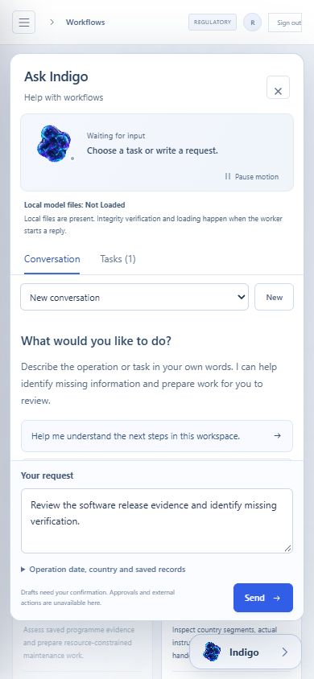
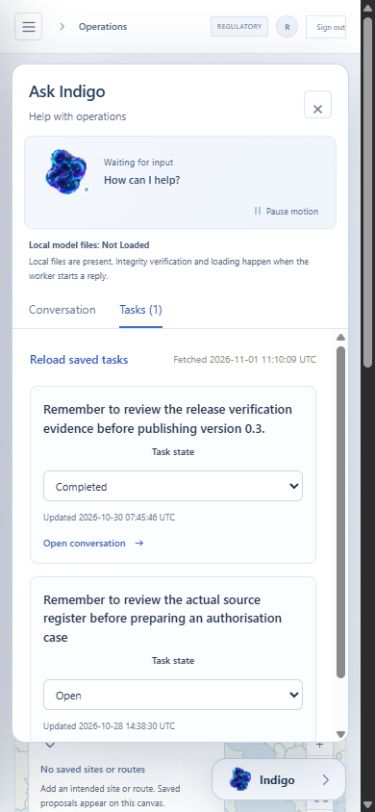
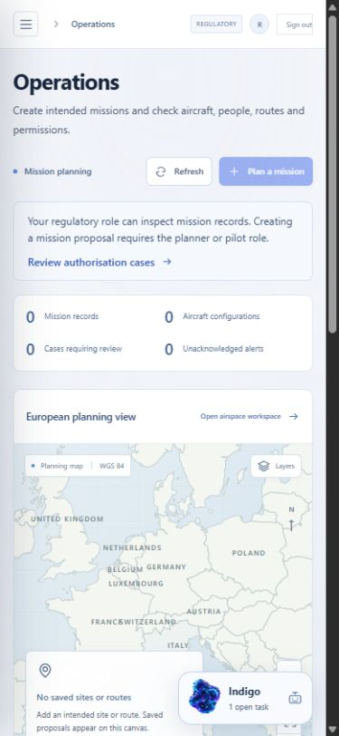

# System Lab Airspace Evaluation

A static viewer of recorded software and model evidence. It is separate from an authenticated operational installation and performs no live inference or external action.

## Application 0.3.4 release

Version 0.3.4-rc.1 is a published engineering candidate from frozen source [f5dd93a7c5c7367101ea63147a5da99cb085addb](https://github.com/michelegiletto-beep/airspace-operations/tree/f5dd93a7c5c7367101ea63147a5da99cb085addb). Its 15,377,087-byte ZIP has SHA-256 `c34bca925553743ef6ce310c909b370a2662e5d5cd098f222d9a5ea6d28a7e57`. All nine public release assets were anonymously retrieved and matched their published digests. [Download the ZIP](https://github.com/michelegiletto-beep/airspace-operations/releases/download/v0.3.4-rc.1/System-Lab-Airspace-Operations-0.3.4-rc.1.zip) or [inspect the release and verification assets](https://github.com/michelegiletto-beep/airspace-operations/releases/tag/v0.3.4-rc.1).

The companion keeps an unsent request with the signed-in user after workspace navigation and reload. Changing the user, organisation, token or role resets its transient view. Draft storage and callback scope checks reject stale updates, including an A to B to A transition; an abandoned concurrent render does not disable the committed user's draft. The normal sign-out path already unmounts the companion. These are software boundary checks, not evidence of a production privacy incident.

The administrative `python -m airspace.cli check` command reports Windows long-path configuration as enabled, disabled or unknown, and calculates representative path lengths in UTF-16 code units. It does not create or migrate a database, create an audit key, change Windows settings or test storage writes. Its schema version identifies supported software, with the existing database explicitly Not Inspected. A setting or short example path does not establish usable storage. Earlier failed Windows attempts and their repair evidence remain recorded.

The frozen Linux source suite passed 576 tests with 20 skipped and 9 warnings. The interface suite passed 180 tests. The exact archive installation separately passed 576 tests with 20 skipped and 3 warnings in 64.01 seconds. [CI 41408782094](https://github.com/michelegiletto-beep/airspace-operations/actions/runs/41408782094) records current container, PostgreSQL, worker and restoration checks. These application results do not measure student quality or establish aviation certification, complete European coverage or operational acceptance.

The actual isolated browser review restored a real unsent software-review request through navigation and reload, and read two existing personal engineering tasks. No Send control was activated; no task or operational record was created and no model worker ran. Four distinct recorded frames demonstrated normal companion motion. Pause and resume controls were observed; capture-tool failures prevented a paused-pixel stability check. Actor changes and reduced motion have separate component-test evidence and are not presented as a two-account browser test.

The existing experimental literal-language student remains unchanged and unpromoted. Original weights, training records, dataset rows, machine labels, splits, rights notices and measured model results are unchanged. No new model generation, training, annotation or benchmark result accompanies this presentation update. The static Space is recorded evidence, performs no live inference and cannot access an authenticated operator workspace or approve an operation.

Actual recorded browser evidence with an unsent software-review request. It is not a model reply, operational observation or training example. The owned artwork retains the rights in [NOTICE.md](NOTICE.md).

## Historical application 0.3.3 release

Version 0.3.3-rc.1 is a published engineering candidate from source [6f8364df25b942d49eb1b4ccaa40f27f70578dbb](https://github.com/michelegiletto-beep/airspace-operations/tree/6f8364df25b942d49eb1b4ccaa40f27f70578dbb). Its 14,192,874-byte ZIP has SHA-256 `067c1b940d520177695402cd469823e35183e4a96d0bbc7af403fd9effb0d6f5`. All nine public assets were anonymously retrieved and matched their published digests. [Download the ZIP](https://github.com/michelegiletto-beep/airspace-operations/releases/download/v0.3.3-rc.1/System-Lab-Airspace-Operations-0.3.3-rc.1.zip) or [inspect the release and verification assets](https://github.com/michelegiletto-beep/airspace-operations/releases/tag/v0.3.3-rc.1).

A failed saved-task fetch now shows an unavailable state and a direct retry. One manual retry reloads only the task list; it does not resend a conversation, create a task, execute an action or call a model. Previous-account results and fetch timestamps are hidden as soon as request identity changes. The current server still enforces actor ownership, permissions and task versions.

The actual source suite passed 544 tests with 20 skipped; the interface suite passed 160 tests with 0 skipped. The exact archive suite separately passed 544 tests with 20 skipped. [CI 41301492234](https://github.com/michelegiletto-beep/airspace-operations/actions/runs/41301492234) identifies the successful engineering dependency job. The isolated browser review changed the first actual successful task read to a 503 and recovered the real response through one manual GET. It preserved the unsent draft, two existing personal engineering tasks and all existing records. These are software checks, not operational acceptance or aviation certification.

The historical experimental student remains unchanged and unpromoted. No model generation, training run, new dataset rows or model-performance improvement accompanies this presentation update. The static Space performs no live inference, operational action or authenticated workspace access. Earlier releases and media remain available unchanged.

Actual isolated software-review capture with existing personal engineering tasks. It is recorded evidence, not a flight, customer record, generated reply or training example. Existing artwork rights remain reserved in [NOTICE.md](NOTICE.md).

## Historical 0.3.2 application candidate

Version 0.3.2-rc.1 is a published engineering candidate from source [2ebb8b20e515d9863a69b072bd963890e219e050](https://github.com/michelegiletto-beep/airspace-operations/tree/2ebb8b20e515d9863a69b072bd963890e219e050). Its 13,796,258-byte ZIP has SHA-256 `1634b9b7e36bd2b80b179a4e0429da7f0c9165434747fc9a62f03ede78cc772e`. All nine public release assets were independently retrieved and matched their published digests. [Download the 0.3.2 ZIP](https://github.com/michelegiletto-beep/airspace-operations/releases/download/v0.3.2-rc.1/System-Lab-Airspace-Operations-0.3.2-rc.1.zip) or [inspect its release and verification assets](https://github.com/michelegiletto-beep/airspace-operations/releases/tag/v0.3.2-rc.1).

The Operations workspace now explains that a regulatory user can inspect mission records while the planner or pilot role is required to create a mission proposal. Disabled controls have an accessible explanation and a separate link opens authorisation cases. Server permissions remain authoritative. The candidate also integrates bounded publication-media encoding checks and correct filenames for new JPEG captures.

The candidate pins `pypdf==6.21.4` for the upstream denial-of-service advisories [GHSA-5849-834g-hvw5](https://github.com/py-pdf/pypdf/security/advisories/GHSA-5849-834g-hvw5), [GHSA-mfr5-77xh-9j7h](https://github.com/py-pdf/pypdf/security/advisories/GHSA-mfr5-77xh-9j7h), [GHSA-cggf-277g-3q54](https://github.com/py-pdf/pypdf/security/advisories/GHSA-cggf-277g-3q54). The initial audit found three advisories in the previous 6.21.3 pin; the failed record is preserved. Local corrected core, frontend and optional-neural scans found no known findings in their selected inputs. This is not a claim that the software is vulnerability-free. The fixed upstream release is [PyPDF 6.21.4](https://github.com/py-pdf/pypdf/releases/tag/6.21.4). Frozen 0.3.1 retains its affected 6.21.3 pin; an existing installation is not updated by a new publication.

The actual current source and exact-archive suites each passed 542 tests with 20 skipped. The interface suite passed 132 tests. Nineteen PostgreSQL checks, actual containers, worker/API completion and backup/restoration passed in [CI41275818880](https://github.com/michelegiletto-beep/airspace-operations/actions/runs/41275818880). The exact archive suite completed in 67.80 seconds. These software checks do not establish aviation certification, complete European coverage or operational acceptance. No new model generation, student training, dataset rows or model-performance improvement accompanies this candidate.

Actual mobile capture from the 0.3.2 software review shows an empty operational workspace and the regulatory-role explanation. It is recorded software evidence, not a flight, customer record, model reply or training example. Existing companion artwork and presentation rights remain reserved as set out in [NOTICE.md](NOTICE.md).

## Historical published software

The 0.3.1-rc.1 release remains available as an unchanged historical candidate. Its 12,504,321-byte ZIP has SHA-256 `0917f468624e35c64829f1591d389fadf51f4528f027d7dc614f1c3fb2b7b750`. Its exact archive passed 479 tests with 20 skipped, with 19 PostgreSQL checks and 123 interface tests recorded separately in [CI41118769822](https://github.com/michelegiletto-beep/airspace-operations/actions/runs/41118769822). These are historical 0.3.1 results, not current 0.3.2 installation evidence.

The historical desktop screenshot is labelled 0.3.1. The new mobile JPEG belongs to the 0.3.2 software review. Old media, original model weights, dataset rows and evidence remain unchanged. The original mobile 0.3.1 capture has JPEG bytes under a `.png` filename in the frozen release; the existing byte-identical `.jpg` presentation copy is preserved.

The experimental student remains unpromoted. No full European coverage, certified service or operational acceptance is claimed. Source documents, upstream models, student files and owned artwork retain their separate rights. The complete historical rights notice is preserved in [NOTICE.md](NOTICE.md).
