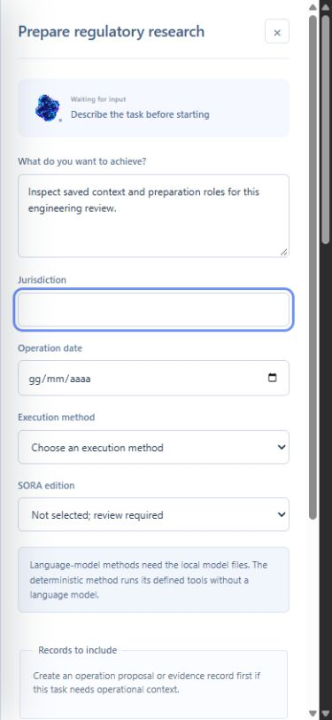
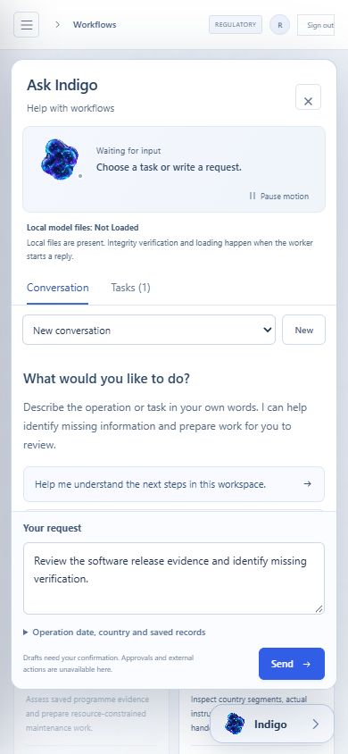
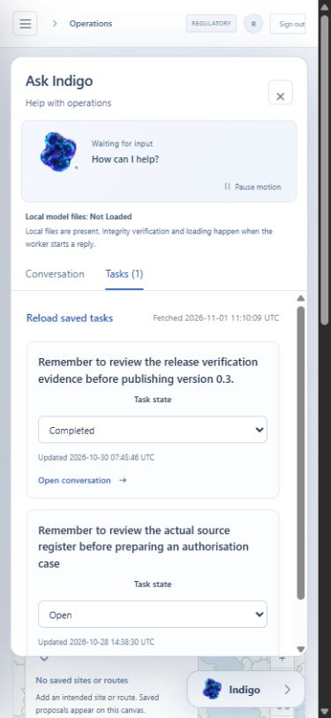
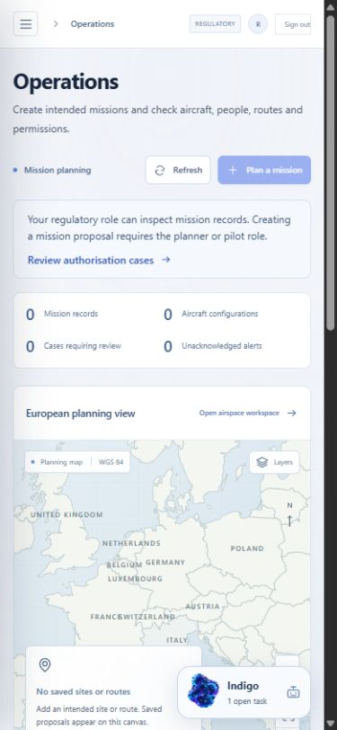
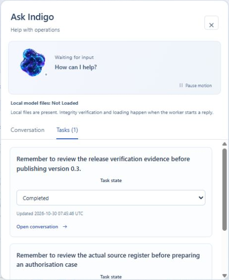

# System Lab experimental literal-language routing student

This repository contains a small experimental classifier for the literal presence of the English word `shall`. It does not determine whether a legal obligation exists, applies or has been met.

This card retains the unchanged experimental student and records context for the published 0.3.5 application candidate. Existing artifacts, rights, training history and measured results are unchanged. Application release gates remain separate.

## Application 0.3.5 release evidence

Version 0.3.5-rc.1 is a published engineering candidate from frozen source [9eead371e8afb5d38293e35d6e4ffef588ae7951](https://github.com/michelegiletto-beep/airspace-operations/tree/9eead371e8afb5d38293e35d6e4ffef588ae7951). All nine public release assets were independently downloaded and matched their published digests. The 16,605,809-byte ZIP has SHA-256 `4c326d37066d6d787aeebe48eeba9932122e3ce052b64dc5bc474bc9ea6e3794`. [Download the ZIP](https://github.com/michelegiletto-beep/airspace-operations/releases/download/v0.3.5-rc.1/System-Lab-Airspace-Operations-0.3.5-rc.1.zip) or [inspect the release](https://github.com/michelegiletto-beep/airspace-operations/releases/tag/v0.3.5-rc.1).

Workflow preparation uses the current server roles and explains who can prepare each task. Missing or invalid permission responses keep the controls disabled. Maintenance and sharing tools expose their required saved inputs, and sharing preparation can include its required saved schedule. These controls do not grant permissions, release maintenance, reserve aircraft or approve dispatch.

Saved workflow context now distinguishes loading, unavailable records and a successfully empty response. Creating a scope stays disabled while context is unknown. A manual retry performs only the nine current workspace-record GETs and preserves the unsent request. Request identity and abort checks prevent obsolete context and fetch timestamps from returning after an actor, organisation, role, token or revision change. Server permissions and saved input-version checks remain authoritative.

Current source CI 42452497352 passed 578 Linux tests with 20 skipped and 19 PostgreSQL tests, actual containers, authenticated worker/API completion and backup/restoration. The interface suite passed 205 tests in 27 files. TypeScript, the production build and three dependency audits passed. The exact archive installation separately passed 578 tests with 20 skipped. The downloadable receipts preserve timings, warnings and measured coverage. Two earlier publication attempts were blocked by the source-integrity gate; the repaired HTML input now produces the exact recorded output bytes. No publication, permission or independent-review gate was removed.

The actual isolated Chrome review forced permission and context read failures, recovered through the relevant GET-only controls, and preserved the real unsent engineering-review request. Exactly nine record GETs recovered the context; that retry sent no POST and created or started no workflow. Desktop, phone and keyboard checks passed, including closing the planner with Escape and restoring the launcher. Independent image-region checks demonstrated normal companion frame progression and stable settled paused frames. The current browser preference was normal; reduced-motion and fallback component coverage remains separate from this browser review.

The original 170 requirements and 28 revision requirements retain their texts and statuses. Original acceptance, stable release and operational acceptance remain incomplete. The experimental literal-language student remains unchanged and unpromoted. Weights, training records, dataset rows, machine labels, splits, rights notices and measured model results are unchanged. No new generation, training, annotation or benchmark result accompanies this presentation. The static Space performs no live inference, authenticated workspace access or external action.

Actual unsent engineering-review request after the form-overlap repair. It is recorded software evidence, not a model reply, flight, customer record or training example. Existing owned companion and presentation rights remain reserved in [NOTICE.md](NOTICE.md).

## Historical application 0.3.4 release

Version 0.3.4-rc.1 is a published engineering candidate from frozen source [f5dd93a7c5c7367101ea63147a5da99cb085addb](https://github.com/michelegiletto-beep/airspace-operations/tree/f5dd93a7c5c7367101ea63147a5da99cb085addb). Its 15,377,087-byte ZIP has SHA-256 `c34bca925553743ef6ce310c909b370a2662e5d5cd098f222d9a5ea6d28a7e57`. All nine public release assets were anonymously retrieved and matched their published digests. [Download the ZIP](https://github.com/michelegiletto-beep/airspace-operations/releases/download/v0.3.4-rc.1/System-Lab-Airspace-Operations-0.3.4-rc.1.zip) or [inspect the release and verification assets](https://github.com/michelegiletto-beep/airspace-operations/releases/tag/v0.3.4-rc.1).

The companion keeps an unsent request with the signed-in user after workspace navigation and reload. Changing the user, organisation, token or role resets its transient view. Draft storage and callback scope checks reject stale updates, including an A to B to A transition; an abandoned concurrent render does not disable the committed user's draft. The normal sign-out path already unmounts the companion. These are software boundary checks, not evidence of a production privacy incident.

The administrative `python -m airspace.cli check` command reports Windows long-path configuration as enabled, disabled or unknown, and calculates representative path lengths in UTF-16 code units. It does not create or migrate a database, create an audit key, change Windows settings or test storage writes. Its schema version identifies supported software, with the existing database explicitly Not Inspected. A setting or short example path does not establish usable storage. Earlier failed Windows attempts and their repair evidence remain recorded.

The frozen Linux source suite passed 576 tests with 20 skipped and 9 warnings. The interface suite passed 180 tests. The exact archive installation separately passed 576 tests with 20 skipped and 3 warnings in 64.01 seconds. [CI 41408782094](https://github.com/michelegiletto-beep/airspace-operations/actions/runs/41408782094) records current container, PostgreSQL, worker and restoration checks. These application results do not measure student quality or establish aviation certification, complete European coverage or operational acceptance.

The actual isolated browser review restored a real unsent software-review request through navigation and reload, and read two existing personal engineering tasks. No Send control was activated; no task or operational record was created and no model worker ran. Four distinct recorded frames demonstrated normal companion motion. Pause and resume controls were observed; capture-tool failures prevented a paused-pixel stability check. Actor changes and reduced motion have separate component-test evidence and are not presented as a two-account browser test.

The existing experimental literal-language student remains unchanged and unpromoted. Original weights, training records, dataset rows, machine labels, splits, rights notices and measured model results are unchanged. No new model generation, training, annotation or benchmark result accompanies this presentation update. The static Space is recorded evidence, performs no live inference and cannot access an authenticated operator workspace or approve an operation.

Actual recorded browser evidence with an unsent software-review request. It is not a model reply, operational observation or training example. The owned artwork retains the rights in [NOTICE.md](NOTICE.md).

## Historical application 0.3.3 release

Version 0.3.3-rc.1 is a published engineering candidate from source [6f8364df25b942d49eb1b4ccaa40f27f70578dbb](https://github.com/michelegiletto-beep/airspace-operations/tree/6f8364df25b942d49eb1b4ccaa40f27f70578dbb). Its 14,192,874-byte ZIP has SHA-256 `067c1b940d520177695402cd469823e35183e4a96d0bbc7af403fd9effb0d6f5`. All nine public assets were anonymously retrieved and matched their published digests. [Download the ZIP](https://github.com/michelegiletto-beep/airspace-operations/releases/download/v0.3.3-rc.1/System-Lab-Airspace-Operations-0.3.3-rc.1.zip) or [inspect the release and verification assets](https://github.com/michelegiletto-beep/airspace-operations/releases/tag/v0.3.3-rc.1).

A failed saved-task fetch now shows an unavailable state and a direct retry. One manual retry reloads only the task list; it does not resend a conversation, create a task, execute an action or call a model. Previous-account results and fetch timestamps are hidden as soon as request identity changes. The current server still enforces actor ownership, permissions and task versions.

The actual source suite passed 544 tests with 20 skipped; the interface suite passed 160 tests with 0 skipped. The exact archive suite separately passed 544 tests with 20 skipped. [CI 41301492234](https://github.com/michelegiletto-beep/airspace-operations/actions/runs/41301492234) identifies the successful engineering dependency job. The isolated browser review changed the first actual successful task read to a 503 and recovered the real response through one manual GET. It preserved the unsent draft, two existing personal engineering tasks and all existing records. These are software checks, not operational acceptance or aviation certification.

The historical experimental student remains unchanged and unpromoted. No model generation, training run, new dataset rows or model-performance improvement accompanies this presentation update. The static Space performs no live inference, operational action or authenticated workspace access. Earlier releases and media remain available unchanged.

Actual isolated software-review capture with existing personal engineering tasks. It is recorded evidence, not a flight, customer record, generated reply or training example. Existing artwork rights remain reserved in [NOTICE.md](NOTICE.md).

## Historical 0.3.2 application candidate

Version 0.3.2-rc.1 is a published engineering candidate from source [2ebb8b20e515d9863a69b072bd963890e219e050](https://github.com/michelegiletto-beep/airspace-operations/tree/2ebb8b20e515d9863a69b072bd963890e219e050). Its 13,796,258-byte ZIP has SHA-256 `1634b9b7e36bd2b80b179a4e0429da7f0c9165434747fc9a62f03ede78cc772e`. All nine public release assets were independently retrieved and matched their published digests. [Download the 0.3.2 ZIP](https://github.com/michelegiletto-beep/airspace-operations/releases/download/v0.3.2-rc.1/System-Lab-Airspace-Operations-0.3.2-rc.1.zip) or [inspect its release and verification assets](https://github.com/michelegiletto-beep/airspace-operations/releases/tag/v0.3.2-rc.1).

The Operations workspace now explains that a regulatory user can inspect mission records while the planner or pilot role is required to create a mission proposal. Disabled controls have an accessible explanation and a separate link opens authorisation cases. Server permissions remain authoritative. The candidate also integrates bounded publication-media encoding checks and correct filenames for new JPEG captures.

The candidate pins `pypdf==6.21.4` for the upstream denial-of-service advisories [GHSA-5849-834g-hvw5](https://github.com/py-pdf/pypdf/security/advisories/GHSA-5849-834g-hvw5), [GHSA-mfr5-77xh-9j7h](https://github.com/py-pdf/pypdf/security/advisories/GHSA-mfr5-77xh-9j7h), [GHSA-cggf-277g-3q54](https://github.com/py-pdf/pypdf/security/advisories/GHSA-cggf-277g-3q54). The initial audit found three advisories in the previous 6.21.3 pin; the failed record is preserved. Local corrected core, frontend and optional-neural scans found no known findings in their selected inputs. This is not a claim that the software is vulnerability-free. The fixed upstream release is [PyPDF 6.21.4](https://github.com/py-pdf/pypdf/releases/tag/6.21.4). Frozen 0.3.1 retains its affected 6.21.3 pin; an existing installation is not updated by a new publication.

The actual current source and exact-archive suites each passed 542 tests with 20 skipped. The interface suite passed 132 tests. Nineteen PostgreSQL checks, actual containers, worker/API completion and backup/restoration passed in [CI41275818880](https://github.com/michelegiletto-beep/airspace-operations/actions/runs/41275818880). The exact archive suite completed in 67.80 seconds. These software checks do not establish aviation certification, complete European coverage or operational acceptance. No new model generation, student training, dataset rows or model-performance improvement accompanies this candidate.

Actual mobile capture from the 0.3.2 software review shows an empty operational workspace and the regulatory-role explanation. It is recorded software evidence, not a flight, customer record, model reply or training example. Existing companion artwork and presentation rights remain reserved as set out in [NOTICE.md](NOTICE.md).

## Model

Run `explicit-shall-20261027-4` uses a frozen MiniLM encoder and a 384 to 32 to 2 ReLU classifier with 12,386 trainable parameters. The student safetensors file is 49,824 bytes, SHA-256 `ff96770308c96b9d96c5f8f6535576e9d791834f76291bf08fce99dcf34d6e6c`.

The separately loaded encoder is `sentence-transformers/all-MiniLM-L6-v2` at revision `1110a243fdf4706b3f48f1d95db1a4f5529b4d41`. Encoder weights and the application's optional Qwen controller are not included in this student file. Model identity does not establish legal or operational reliability.

## Data and results

A local FLAN-T5-base teacher annotated 288 actual English EU legal passages. Source and schema checks quarantined 42 annotations. The remaining 246 accepted annotations are machine generated and unreviewed. They are not expert ground truth.

Whole source families define the splits: Regulation 2019/947 for training, 2019/945 for validation and 2021/664 for testing. Accepted counts are 82, 87 and 77. Exact text overlap was excluded. Independent time and edition holdouts were unavailable.

| Method | Agreement with held-out machine labels | Samples |
| --- | ---: | ---: |
| Student | 81.82% | 77 |
| Deterministic literal-word check | 100.00% | 77 |
| Trained hashed lexical baseline | 63.64% | 77 |
| Frozen pretrained prototype | 58.44% | 77 |
| Training-majority baseline | 46.75% | 77 |

The student's Wilson 95% interval is 71.76 to 88.85% for this limited agreement measure. Its Brier score is 0.153. The exact-word validation filter makes the deterministic baseline perfect by design. The student has not demonstrated a benefit over that baseline and remains experimental and unpromoted. Its probabilities are not calibrated legal confidence.

Three earlier semantic annotation attempts failed and remain in the lineage. Historical training used the recorded PyTorch 2.6.0+cu126 environment; later inference dependency updates did not constitute retraining.

## Use and limits

The application can display the result as an optional routing signal for review. It must not approve a case, permission, maintenance release, schedule, dispatch or emergency action. No operational prediction model was trained.

Load through `airspace.neural.ExperimentalStudent` with the pinned encoder. There is no hosted model service configured by this card. The [public evidence Space](https://huggingface.co/spaces/Magic51/system-lab-airspace-evaluation) displays recorded evidence and performs no live inference. The [application repository](https://github.com/michelegiletto-beep/airspace-operations) provides actual installation and release status. The [0.3.1 application candidate](https://github.com/michelegiletto-beep/airspace-operations/releases/tag/v0.3.1-rc.1) has its own software verification and public download records. These do not establish model quality or operational acceptance.

Promotion would require qualified human labels, representative evaluation across dates, versions and jurisdictions, appropriate calibration and a demonstrated practical benefit. Another model's agreement is not expert review.

The student/code licence does not relicense source documents, upstream models or existing System Lab artwork and presentation files. Those retain their own rights. This documentation preparation does not change the previously published weights.

## Historical 0.3.1 application context

This actual 0.3.1 software-review capture shows existing personal engineering tasks. It contains no flown mission or customer activity. The screenshot is recorded evidence, not an interactive assistant or a new training example. No model reply was requested for this capture.

The installed application's owned companion animates during normal motion mode. Its fallback also animates; user pause and reduced-motion preferences take precedence. Conversations and personal tasks are private to the signed-in actor. Typed internal draft actions require explicit confirmation and current server-enforced permissions and input versions. The application uses the shared System Lab agent core through domain-specific tools. This does not grant the student authority to approve its own work.

Candidate 0.3.1 passed 479 source tests and a separate exact-archive installation with 479 passed and 20 skipped. Its interface suite passed 123 tests. Nineteen PostgreSQL tests, actual containers, worker/API completion and restoration are recorded in [CI41118769822](https://github.com/michelegiletto-beep/airspace-operations/actions/runs/41118769822). Those software results are separate from this student's unchanged evaluation. [Inspect frozen source433e89](https://github.com/michelegiletto-beep/airspace-operations/tree/433e89a66038ee7f7c34cb443c03eeafdee92f36).
